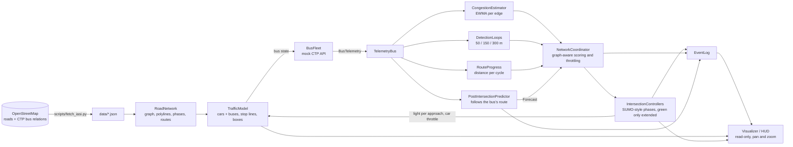
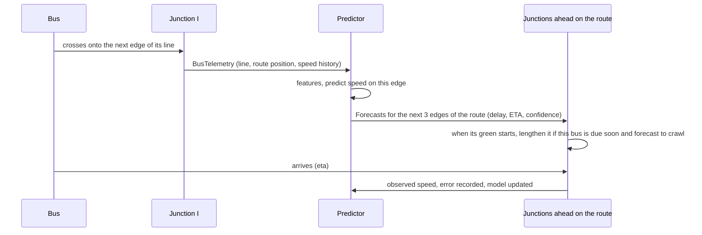

# Smart City Traffic Demo: Architecture

A visual demo of adaptive traffic-signal control on the **real road network of central Iași, Romania**. Individual cars and buses drive on one-lane roads; the buses follow real CTP Iași lines and double as moving congestion sensors. Only the buses are observed, never the cars, so no light is ever cut short: once per red-green cycle each junction checks how far the buses heading for it got, and lengthens its green only if they covered very little distance. It also avoids releasing cars toward an overloaded junction. An AI module forecasts what each bus will meet on the next links of its route and feeds that forward so the junctions ahead adjust before the bus arrives.

**Target:** Python 3.14 (3.14.8), `pygame-ce`, `numpy`, `networkx`, `pytest`; `osmnx` and `shapely` only to rebuild the dataset (see `requirements.txt`).

**Status:** implemented. The earlier grid-based demo was refactored onto the real map (see `docs/REFACTORING_PLAN.md`); section 12 records what was measured. Run it with `python -m smartcity.main --incident-at 60`.

---

## 1. Overview and data flow

The world (cars, buses, and the signals' effect on them) is simulated microscopically. Controllers see **only** bus telemetry plus their own signal state, never the world's vehicle positions. The buses really are the sensors.



One simulation tick (`dt = 0.1 s`):

1. Each `IntersectionController` advances its phase timer.
2. `TrafficModel` moves every vehicle along its edge polyline: car-following, stop lines, crossing junctions, spawning and removing cars at the gates.
3. `BusFleet` publishes one `BusTelemetry` per bus.
4. The estimator, detection loops and predictor consume the telemetry.
5. Every 0.5 s the `NetworkCoordinator` refreshes loads and throttles. Controllers decide only once per cycle, at the moment a green starts.

Everything except rendering is headless and testable with `pytest`.

---

## 2. The Iași dataset (`scripts/fetch_iasi.py`)

Run once; the output (`data/iasi_core.json`, `data/iasi_routes.json`, about 180 KB) is committed so the app starts offline and tests are deterministic. The raw downloads go to `data/raw/` (git-ignored).

1. **Area.** A box (47.147-47.186 N, 27.553-27.607 E) covering Copou, Păcurari, Bd. Independenței, Piața Unirii, Gara, Palas, Podu Roș and Tudor Vladimirescu. OSMnx downloads its drive network (1,194 nodes, 2,770 edges, 307 km).
2. **Bus lines.** Overpass returns the `route=bus` relations of network "CTP Iași" in the box (stops in order, way members). For each chosen line (19, 28, 36, 41, 20, 42, 43, 47) the stops are snapped to graph nodes and joined by shortest-time paths that strongly prefer the relation's own ways, giving a contiguous edge sequence. The return direction comes from the opposite relation, or from a shortest path back when OSM has none (line 36). The result is a cyclic edge list per line.
3. **Crop for 60 FPS.** Keep primary, secondary and tertiary roads (plus their links) and every edge a bus route needs, then the largest strongly connected component (1,149 edges).
4. **Merge junction clusters.** `osmnx.consolidate_intersections` (25 m tolerance) merges dual carriageways and roundabout nodes into single junctions, which also removes every edge shorter than 30 m. Route edges are mapped through the merge.
5. **Result:** 352 nodes, 710 directed edges (125 km), speed limits from `maxspeed` tags (50 km/h urban default; 20-70 km/h occur), edge polylines, street names, and 8 routes of 6-17 km each.

Map data (c) OpenStreetMap contributors, ODbL.

---

## 3. Module layout

Package `smartcity/`:

| Module | Responsibility |
|---|---|
| `config.py` | Frozen dataclass holding all tunables |
| `network.py` | `RoadNetwork`: graph of `Intersection`s and polyline `Segment`s with speed limits and stop lines; phase grouping by heading; turn options; gate selection; `networkx` routing; lat/lon projection |
| `data.py`, `synthetic.py` | Load the committed Iași data into plain `GraphData`/`RouteData`; a small synthetic grid with the same interface for tests |
| `traffic_model.py` | `TrafficModel` and `Vehicle`: the microscopic world and its physical rules |
| `mock_api.py` | `BusFleet` (places buses on their lines, emits telemetry), `TelemetryBus` (pub/sub), `BusTelemetry` |
| `congestion.py` | `CongestionEstimator`: per-edge EWMA of bus speed ratio, load, confidence |
| `detection.py` | `DetectionLoops`: virtual loops at 50/150/300 m before every stop line, built from bus telemetry; finds the buses heading for a junction |
| `progress.py` | `RouteProgress`: how far each bus has travelled along its line (unwrapped odometer and a short history), from telemetry alone |
| `predictor.py` | `PostIntersectionPredictor`: the feed-forward AI module, following each bus's route |
| `controller.py` | `IntersectionController` (phase machine; the per-cycle bus check) and `NetworkCoordinator` (graph-aware loads and throttle, evidence from buses, budget) |
| `events.py` | `EventLog` of forecasts, adjustments, throttles, incidents |
| `simulation.py` | Headless fixed-step engine wiring everything together |
| `visualizer.py`, `hud.py` | `Camera` (projection, pan, zoom), city renderer, dashboard |
| `main.py` | Entry point, key and mouse handling, `--compare`, `--screenshot` |

---

## 4. Road network and signals

**Graph.** Every OSM edge is a one-lane directed `Segment` from one intersection centre to the next along its polyline (`length` from OSM, scaled geometry, `speed_limit`, street `name`, headings at both ends). Two-way streets are two segments; one-way streets are one. Vehicles keep to the right-hand lane (3 m off the centre line).

**Stop line and junction box.** Vehicles stop at the *stop line*, 14 m before the centre of the junction they approach (or 40% of the edge, if shorter). The area between the stop lines is the box.

**Signalised junctions.** Every node with at least three incoming roads (and not a gate) gets signals: 76 of 352 in the Iași graph, which is more than the real city has. Nodes with fewer approaches are plain bends or merges with no signal.

**Phases from geometry.** Incoming approaches are grouped by heading: two approaches whose headings are within 40 degrees of opposite share a green (greedy best match), and an unpaired street has a phase of its own. A crossroads gets two phases, a T-junction two (the through road, then the stem), a five-way junction three. A left turn is any turn of more than 35 degrees to the left; turn shares prefer going straight (U-turns only at dead ends).

**Safety timings (SUMO-style, in `config.py`).** A green never lasts less than `min_green` = **7 s** (no flickering) and is never ended early: it is the standard 20 s, possibly *extended* (below), and only then comes **yellow 3 s**; then an **all-red clearance of 2 s** before the conflicting phase starts. At most 45 s. Phase state is `GREEN → YELLOW → ALLRED → next phase`. Neighbouring junctions start desynchronised.

**Gates.** Boundary nodes of the cropped map with traffic both ways (10, spread by farthest-point sampling) are gates: cars appear on their outgoing edges and leave when they reach their destination gate.

**Routing.** Cars follow the fastest `networkx` path (Dijkstra on free-flow travel time, cached) from a random gate to another. Buses follow their line's cyclic edge list. Both are plain edge sequences: no random walks.

**Projection.** `LocalProjection` maps latitude/longitude to metres east/north of the map centre (equirectangular); `Camera` maps those to screen pixels with pan and zoom (`Camera.latlon_to_screen`).

---

## 5. Vehicle rules (`TrafficModel`)

Identical in fixed and adaptive mode, in plain Python in the spirit of SUMO's safety rules:

- *Red:* a vehicle holds at the stop line; nothing enters the box while its light is red.
- *Yellow:* a vehicle stops if it can still do so with maximum braking; only vehicles too fast to stop continue.
- *Green:* a vehicle crosses only if there will be room on the start of its next edge when it reaches the junction centre (whoever is last on that edge will have moved on by then, unless it is standing in a queue or stalled), so nobody enters the box without room to leave it.
- *Car-following:* a vehicle keeps a safe distance behind the one ahead along the polyline (`v <= sqrt(2 * a_comfort * room)`), with no overtaking, so vehicles never overlap and never jump across nodes.
- *Speed:* each vehicle drives at its edge's speed limit (cars vary by up to 8%), accelerating at 1.8 m/s² and braking at up to 6 m/s².
- *Both sides pass together:* nothing yields to oncoming traffic. The two opposite streets of a green phase (and a left turn across the oncoming one) go at the same time and simply cross inside the box; when two streams merge into the same edge, the later vehicle falls in behind the earlier one as it lands. This keeps a left-turner from holding up everyone behind it on a one-lane road.
- *Throttle:* when the coordinator meters an approach, cars (not buses) are released no faster than `sat_flow * g`.
- *Incident:* a stalled vehicle parks mid-edge for 150 s. On a one-lane road nobody can overtake, so the lane is blocked.

---

## 6. Sensing: estimator and virtual detection loops

**Estimator.** EWMA of the bus speed ratio (speed over the edge's limit) per edge from mid-edge samples only (30 m past the previous junction, 40 m before the stop line), because speed near a signal reflects the signal. Confidence decays with staleness (`exp(-age / 90 s)`) and load is blended toward a neutral prior (0.25), so an unvisited edge is *unknown*, not *clear*.

**Detection loops.** Each approach has virtual windows 50, 150 and 300 m before its stop line. A bus counts toward a window when its *road distance* to that stop line is within it, and the windows reach back across junctions: the loops are indexed by walking upstream edges that can turn into the approach. From the buses inside, a window yields counts, speed ratios and a density estimate:

- buses still moving contribute their slowdown (`1 - speed ratio`), weighted 0.5 / 0.3 / 0.2 from near to far;
- a *standing* bus (under 30% of the limit) proves a queue at least as long as its distance, so it sets a floor on how full the approach edge is (a bus 80 m back on a 150 m edge means a half-full edge, not a jam; one standing on the previous street means the queue covers the whole edge);
- a standing bus within 40 m of its own stop line is ignored (it is waiting for its signal or pulling away).

The density feeds the load estimate that the throttle uses; the windows' other job is to say which buses are heading for a junction (`buses_near`). A bus on an earlier edge counts only if *its own route* continues onto the approach within the next three edges.

**Route progress.** `RouteProgress` turns each telemetry record into a distance along the bus's line (position of its edge on the route plus the distance along the edge, unwrapped over laps) and keeps a one-second history. `travelled(bus, now, span)` answers how many metres the bus covered during the last `span` seconds (or `None` if it has not been watched that long).

---

## 7. Global optimisation across the graph

1. **Graph-aware downstream gating (throttle).** For each approach the coordinator looks at every edge it can release into *and at the junction at the end of that edge*: the worst of `load(edge)` and `0.85 * junction_load(next node)`, where a junction's load is the mean of its two most loaded approaches. It meters car releases only when that is clearly worse than the edge the cars are leaving (backpressure: do not shift the bottleneck):

   ```
   excess = downstream - max(rho_gate, load_up)
   g      = 1 if excess <= 0 else clamp(1 - excess / (rho_block - rho_gate), 0, 1)     # rho_gate 0.65, rho_block 0.85
   ```

   So releasing onto a perfectly free edge is still throttled when the junction it leads to (say a rush-hour Podu Roș) is overloaded. Metering is waived while a bus is in the 150 m window of the approach, because buses cannot overtake the cars they would be held behind.

2. **Physical spillback.** The world enforces that nobody enters a box without room to leave it, so a queue that reaches a junction blocks that approach on green too.

3. **The per-cycle bus check (the only observed-evidence extension).** Each phase remembers when it last turned green. When it turns green again, that is one red-green cycle later, and the controller asks, for every bus within 300 m of one of the phase's stop lines whose route continues onto it: *how far did this bus get during the cycle?* The answer is compared with what the speed limit would have allowed:

   ```
   share = metres travelled during the cycle / (cycle length * speed limit)
   if share < 0.30 for the worst-held bus:
       extension = 12 s * (1 - share / 0.30) * downstream openness    # scaled down toward 0 as the streets ahead jam
   ```

   Only a bus that was watched for the whole cycle is judged; a bus that arrived during the last red and then crossed is not "low". If every bus got through, nothing changes. The extension is added to that green only; the budget below and `max_green` (45 s) cap it. The log says exactly why, for example: *bus B21 L43 covered 113 m in the last 50 s cycle (14% of free flow)*.

4. **Feed-forward from the AI forecasts.** A forecast that a bus due within 30 s will make low progress on an approach of the starting phase (predicted density at least 0.2, confidence at least 0.3) lengthens the green that is starting by 6 s, once per forecast. This is the same idea as the cycle check, applied before the bus has been seen to stall.

5. **Extension budget.** Total extension seconds across the network per rolling minute are capped, and extensions are damped when a neighbouring junction just extended (`networkx` neighbours).

6. **No early endings.** Because only buses are observed, a green is never shortened and never cut off: phases keep their fixed order and the standard length, so no street can be starved.

Removed after measurement or on principle: a "spillback guard" that skipped or cut short phases whose exits looked full (it cost buses a few points and did not reduce jams); score-sized greens, early switches and out-of-order jumps, which decided about the *cars* from estimates and shortened some greens to lengthen others. Their code and settings are gone.

---

## 8. AI post-intersection prediction (feed-forward, along the route)



**Trigger.** A bus's telemetry shows it has moved onto a new edge of its line.

**Features** (over its last 3 edges): mean speed ratio, last ratio, delay rate (fraction of time lost), trend. **Model:** an EWMA baseline at cold start, then an **online ridge regression** (NumPy, window of 200 outcomes) after 25 outcomes, predicting the speed ratio on the edge just entered. Rolling MAE of speed and ETA is shown on the HUD.

**Following the predefined route.** Telemetry carries the bus's line and position along it, and the predictor looks the line up in the public route table. It forecasts the edge the bus just entered and the next two edges **of that route** (wrapping around the loop), each with `predicted_density = 1 - ratio`, an ETA built from edge lengths and limits, a `predicted_delay` (extra seconds over free flow on that edge) and a confidence that falls with each hop. When the bus clears the next junction, the window moves one edge forward and fresh forecasts are issued ahead of it.

**Consumption.** When a phase turns green, forecasts for its approaches whose bus is due within 30 s and is predicted to make low progress lengthen that green by 6 s (`PREDICTIVE_EXTEND`), once per forecast. Nothing in the forecast can shorten or end a green. The forecast also raises the `fc_load` of its edge, which feeds the junction loads used by the throttle. Because the regression shrinks toward the mean, predicted densities are modest, so the trigger threshold is low (0.2) and predictive extensions are rare.

---

## 9. Mock API (the bus feed)

- In-process, 10 Hz of simulation time, no network. It stands in for a high-rate AVL feed.
- 26 buses on 8 CTP lines (19, 28, 36, 41, 20, 42, 43, 47), spaced evenly along each line's loop, 2-5 per line by length (one per 3.5 km). They share the road with cars, queue at the same lights and obey the same junction rules.
- Each tick, one `BusTelemetry` per bus: ID, line number, position along the line, coordinates, distance to the next stop line, speed, the edge's speed limit, accumulated delay. Consumers `subscribe`; a ring buffer keeps recent records for the HUD.
- Deterministic given a seed. Cars are *not* in the feed.

---

## 10. Visualizer and dashboard

- **Projection and camera.** Latitude/longitude to metres to screen, with mouse-wheel zoom about the cursor, drag to pan, `F` to fit, `+`/`-` and arrow keys. The road layer is cached and only re-rendered when the view settles (while dragging, the old layer is shifted). Road width is exaggerated when zoomed out and true to scale when zoomed in.
- **Look.** Dark theme with asphalt-grey road vectors sized by road class, sleek junction rings, neon stop-line bars for each approach (green `#39FF14`, yellow, red `#FF1744`), cars as small blue rectangles, buses as long rectangles coloured neon red-amber-lime by speed with their line number chip, faint coloured CTP line corridors (`L`), landmark labels (Copou, Păcurari, Gara, Piața Unirii, Palas, Podu Roș, Tudor Vladimirescu), rings where an adjustment fires, cyan diamonds for AI forecasts, a red X on the stalled vehicle, a scale bar.
- **HUD panels.** Live CTP telemetry table (bus ID, line, speed, distance to the line, delay, AI extra delay ahead); AI predictions (model, error, upcoming forecasts with predicted delay); the three loudest virtual detection loops; automated cycle adjustments (every override of the standard timer, with the reason: `EXTEND`, `PRED-EXT`, `THROTTLE`); metrics.
- **Keys.** `B` adaptive/fixed, `I` incident, `Space` pause, `1`/`2`/`4`/`8` speed, `H` heat layer (off / true occupancy / estimated load), `L` bus lines, `[` `]` traffic amount, `\` normal traffic, `K` / `Shift+K` or a click on a key point for rush hour, `R` reset, `Q` quit.
- **Traffic amount and rush hour (runtime controls).** `Simulation.set_traffic_percent` takes 0 to 1000 (100 is normal) and `step_traffic` walks the ladder 0, 10, ... 100, 150, 200, 300 ... 1000. It scales the car spawn rate at every gate and the bus fleet (the normal 26 buses split over the 8 lines; 1000% is 260; 0% is none) and changes the vehicles already on the map at once: lowering removes a random share of the cars and the most recently added buses, raising scatters extra cars and buses on free spots, 0% empties the map and 100% after 0% brings back a normal start. Buses taken off the map are forgotten by the detection loops, the odometer and the predictor, so no ghost telemetry remains. `set_rush_point` puts one of the 8 key points under pressure: the nearest signalised junction becomes a rush node, `rush_seed` commuter cars are placed on gate-to-gate routes through it straight away, and an extra stream of `rush_extra` times the normal gate demand (also scaled by the traffic amount) is routed through it from every gate, with no U-turn there. Pressure is thus extra *demand through the junction*: no signal or algorithm is changed. Reset keeps both settings. Command line: `--traffic PERCENT`, `--rush KEY_POINT`.

---

## 11. Testing strategy

Everything except the window is headless. 150 tests:

- **Network and geometry:** projection round trip, compass names, polyline position and lane side on a bent road, stop-line set-back; phase grouping on crossroads, T, skewed, five-way and two-approach nodes; turn options without U-turns; gates; routing.
- **Iași dataset:** real streets and landmarks present, lengths and limits plausible, the requested lines (19, 28, 36, 41) present and contiguous, routes run along their streets, every gate reaches every other, every signalised junction has valid phases.
- **World rules:** stop line on red, proceed on green, queue gaps, edge speed limits, wait when the exit is full, yellow, throttle spacing, buses not throttled, both sides of a green phase crossing in lockstep, a left-turner holding up neither the cars behind it nor the oncoming side, merging streams falling in behind one another, stalled vehicle, cars follow gate-to-gate routes.
- **Signals:** opposite lights match at every junction at every tick (300 s of the real map); one phase non-red at a time; every street served; phase order green-yellow-all-red; **7 s minimum green, 3 s yellow and 2 s all-red measured**, including with adaptive extensions; **a green is never shorter than its standard time and its planned length only ever grows**.
- **Sensing and controllers:** detection windows including across junctions, standing-bus rules, queue occupancy, route-aware `buses_near`; the route odometer (laps, history, unjudgeable buses); **the per-cycle check: a bus that barely moved gets the green extended, one that made good progress changes nothing, extensions scale with the shortfall, no judgement without a whole cycle of history or a previous green, far or off-route buses ignored, no extension into jammed streets, cap and budget, fixed timers unaffected**; the graph-aware throttle (an overloaded *downstream junction* throttles an upstream release onto a free edge) and its bus waiver; predictive extension.
- **Prediction:** forecasts follow the route for three hops and wrap; the window moves ahead as the bus clears junctions; unknown lines get one hop; error recording, expiry, ridge learning.
- **Whole runs on the real map (both control modes):** no vehicle ever crosses a stop line on red, no two vehicles overlap, the box is clear when a new phase turns green, buses and cars never leave their routes, and adaptive control stays close to fixed timers while never cutting a green short.
- **Traffic amount and rush hour:** the ladder and its clamps; 100% changes nothing (identical run); 0% leaves no cars or buses and nothing spawns; bus counts at 10/50/150/300/1000%; cars thinned or added at once; the spawn rate follows the percentage; removed buses are forgotten by every consumer; returning from 0% restores a normal fleet; lanes stay ordered at 1000%; the eight key points exist and each maps to a real signalised junction; case-insensitive choice and rejection of unknown names; cycling; commuters routed through the junction; rush hour raises the cars near Copou and Podu Roș at least twofold; lifting it; rush hour at 0% stays empty; keys, Shift+K, backslash, clicking a key point (and not dragging) and command-line validation.
- **Rendering:** camera projection and zoom invariants, every heat and line mode on both maps, the interactive loop with keys and mouse, screenshots, all under `SDL_VIDEODRIVER=dummy`.

---

## 12. Results, risks and open items

**Measured** (`python -m smartcity.main --compare --seeds 6`: a vehicle stalls on the busiest bus corridor from t=120 s to t=270 s, 600 s per run, default demand of 0.08 cars/s per gate):

| mode | bus time lost | car speed (share of limit) | edge-seconds half-occupied | cars exited | adjustments |
|---|---|---|---|---|---|
| fixed timers | 36.2% | 64% | 179 | 278 | 0 |
| adaptive | 35.6% | 62% | 172 | 277 | 220 |

Other demand levels (bus time lost / car speed / jam edge-seconds / cars exited, fixed then adaptive):

| demand (cars/s per gate) | seeds | fixed timers | adaptive |
|---|---|---|---|
| 0.045 | 4 | 35.5% / 67% / 34 / 223 | 35.1% / 65% / 44 / 221 |
| 0.06 | 4 | 35.6% / 65% / 66 / 252 | 35.3% / 64% / 74 / 250 |
| 0.08 (default) | 6 | 36.2% / 64% / 179 / 278 | 35.6% / 62% / 172 / 277 |

Ablation at the default demand (6 seeds; bus time lost / car speed / jam / exited): fixed 36.2% / 63.5% / 179 / 278; everything on 35.6% / 62.5% / 172 / 277; no throttle 35.5% / 63.1% / 194 / 275; throttle only 36.3% / 62.7% / 163 / 278; no cycle extension 36.3% / 62.5% / 175 / 277.

- **Performance.** A frame at 1x speed costs about 9 ms (map and dashboard 5 ms, six simulation ticks 3.4 ms), so the demo holds 60 FPS; at 4x about 53 FPS; the loop keeps the window responsive at 8x. A 15-minute run simulates in about 6 s headless.
- **With only bus evidence and extend-only greens, adaptive control is close to a wash.** The per-cycle check fires a few dozen times in ten minutes and each time cites a bus that really was held (113 m in a 50 s cycle, and so on). It lowers bus time lost by about 0.7 points relative to the throttle alone and 0.6 points relative to fixed timers, at the cost of a little green taken from the cross street. The throttle, which the brief asks for to prevent shifting a bottleneck, costs car speed (about one point) and changes how long edges stay half-full little. Net: bus time lost 0.3 to 0.6 points lower, car speed 1 to 2 points lower, throughput within 1%, jams unchanged within noise. An earlier version that also shortened some greens to lengthen others (score-sized splits and early switches, which decided about cars from estimates) measured better for buses (1.7 points at the default demand, under the previous traffic rules) and for jams; removing those, as required because the cars are not observed, gives that up.
- **Free-flowing both sides help every mode.** Letting both sides of a phase pass together (no yielding, entry room judged for the moment of arrival) made the baseline itself much better than before: at the default demand fixed timers now lose 36.2% of bus time (was 38.0%), cars average 64% of the limit (was 59%), and half-occupied edge-seconds fell from 328 to 179.
- **Differences from the request.** CTP's lines as described in the brief (28: Dacia - Podu Roș - Triumf; 41: Dacia - Podu Roș) do not match OpenStreetMap, where line 28 is Dacia - Copou and line 41 is Blocuri Ciurea - Piața Independenței. The dataset uses the OSM relations, since that is what can be queried; line 19 (Canta - CUG) and 36 (Dacia - Breazu) match. Only the part of each line inside the cropped map is simulated, and OSM relations are volunteer-maintained and may differ from CTP's current timetable.
- **Simplifications.** One lane per direction whatever OSM `lanes` says; only primary/secondary/tertiary roads (plus what the routes need), so residential streets are absent; every junction with three or more approaches is signalised, whereas only some are in reality; no pedestrians, lane changes or turn lanes; no collision physics inside the box (opposite streams and left turns pass through each other there); unsignalised bends and merges give way only by the room check. Speed limits come from `maxspeed` tags with a 50 km/h urban default.
- **Nobody yields.** A model that made left-turners wait for gaps was dropped because on one lane the waiting vehicle blocked its whole approach while the oncoming side flowed. Over ten simulated minutes the number of vehicles standing at a green line six seconds or more into the green fell from 468 to 13 (the rest wait for a full road ahead).
- **Predictive extensions are rare.** The model works but regresses to the mean, so few forecasts are dense enough to act on; the per-cycle check does most of the work. ETA error is large (roughly 15-25 s) because forecast arrivals ignore waiting at red.
- **Bus-only sensing** means unvisited edges have no fresh data; confidence decays to a neutral prior, so the controllers see the *neighbourhood of the buses*, not the whole city.
- **Rush hour** is extra demand routed through one chosen key point (see section 10), not a time-of-day profile; the key point is the nearest signalised junction to the label, which can be 100-200 m away. Measured over four simulated minutes on two seeds, the average number of cars within 400 m of the junction rose from 0.2-22 to 25-87 and of standing cars from 0.1-5.5 to 6-42, depending on the point.
- **At 1000% the city is gridlocked on purpose.** Ten times the cars is far beyond what a one-lane network can move, so queues spill back to the gates and `queued at gates` climbs. A frame costs about 30 ms at 1000% after 90 s (roughly 33 FPS, and the simulation falls behind real time at 1x because the loop keeps the window responsive); 300% still holds 60 FPS. Weights and thresholds are hand-tuned on a few seeds, not optimised.

---

## 13. Running it

```bash
python3.14 -m venv .venv && source .venv/bin/activate && pip install -r requirements.txt
python -m smartcity.main --incident-at 60      # interactive demo on Iași (press B to compare with fixed timers)
python -m smartcity.main --map grid            # the small synthetic city
python -m smartcity.main --compare             # headless fixed vs adaptive table
python scripts/fetch_iasi.py --refresh         # rebuild the dataset from OpenStreetMap (needs network)
pytest                                         # tests (headless)
```
