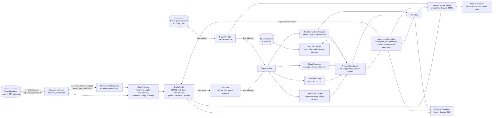

# Noodle Traffic Control: System Architecture

A microscopic urban traffic digital twin and real-time adaptive traffic-signal control platform built on the **real road network of Iași, Romania** (~18 × 15 km, from Breazu & Copou to Blocuri Ciurea, CUG, Păcurari, and Tătărași).

The system operates in two modes:
- **`Aether (Simulation)`** — Full multi-lane, multi-class microscopic traffic simulation with **51 real CTP Iași + AMTPI bus lines** (160 scheduled buses), ~1,500 OD-routed vehicles across **1,183 apartment blocks and houses**, **16 real Iași car roundabouts**, **14 CTP *rond* transit turnaround loops**, **35 unsignalized *Cedează* yield junctions**, **115 signalized intersections**, **222 real CTP bus stops**, hills, crosswalks, rail crossings, weather, 24h rush waves, urban double-parking friction, and hospital ambulance green-wave preemption.
- **`Terra (Real)`** — Live real-world transit feed streaming real-time CTP Iași bus GPS positions from the **Tranzy Open Data API** (`api.tranzy.ai`, Agency `#1`), snapped onto the Iași road graph by a vectorized `MapMatcher` to generate live AI green-hold advisories and optionally sync real deployed fleet counts back into `Aether`.

Controllers observe **only bus telemetry** (plus their own signal state and emergency ambulance preemption requests), never private car positions. Green phases obey SUMO-style safety timings and are **never cut short**; the AI only holds or extends green when bus evidence justifies it, meters upstream inflows toward overloaded downstream junctions, learns per-junction trust online via counterfactual odometer grading, and persists learned policies + Ridge predictor weights in crash-safe versioned JSON save slots.

**Runtime & Dependencies:** Python 3.12+ (target 3.14), `numpy`, `networkx`, `fastapi`, `uvicorn`, `requests`, `pygame-ce` (optional legacy desktop view), `pytest`; `osmnx` and `shapely` only to rebuild raw OSM geometry (`requirements.txt`). A standalone client-side JavaScript engine (`web/standalone_sim.js`) also runs zero-backend on GitHub Pages (`docs/`).

---

## 1. End-to-End Architecture & Data Flow



One `Aether` simulation tick (`dt = 0.1 s`):
1. Each `IntersectionController` advances its phase timer (`GREEN → YELLOW → ALLRED`) and evaluates real-time **Bus Green Holds** and **Emergency Ambulance Preemption**.
2. `TrafficModel` updates active incidents, urban friction, crosswalks, CFR rail barriers, resting terminus buses, recessed bus-bay departures, circular roundabout rings, Wave 2 residential OD spawning, periodic MOBIL lane changes (`~3.3 Hz`), and per-lane car-following / stop-line / yield / bus-stop physics.
3. `BusFleet` publishes one `BusTelemetry` per driving bus (`10 Hz`, flagging `at_stop` during passenger boarding and forgetting buses during terminal layovers/breaks).
4. `CongestionEstimator`, `DetectionLoops`, `RouteProgress`, and `PostIntersectionPredictor` consume the telemetry stream.
5. Every `0.5 s` (`decision_period`), `NetworkCoordinator` refreshes 1-hop and 2-hop downstream loads and turn-share-weighted car throttles.
6. `JunctionLearner` self-grades completed extensions after yellow and updates per-junction trust in RAM; `SlotRuntime` flushes atomically to disk on periodic checkpoints (`300 s`), slot switches, or clean shutdown (`atexit`).

Everything except rendering is headless and covered by **195 automated `pytest` tests**.

---

## 2. The Iași Dataset Pipeline

All processed JSON datasets are committed in `data/` (and mirrored into `docs/data/` by `scripts/build_gh_pages.py`), so the app starts completely offline and tests are deterministic.

| Script | Output | Summary |
|---|---|---|
| `scripts/fetch_iasi.py` | `data/iasi_core.json`, base `data/iasi_routes.json` | Downloads the Iași drive graph (`47.095–47.213° N`, `27.465–27.640° E`) and base OSM CTP bus relations via Overpass/OSMnx, crops to the strongly connected arterial + transit spine, consolidates junction clusters (`25 m` tolerance) → **263 nodes, 667 directed edges (428 km)** and 18 base OSM routes. |
| `scripts/expand_ctp_routes.py` | `data/iasi_routes.json` | Preserves the 18 OSM routes (adding exact `turnaround_leg` indices for terminus layovers) and adds the remaining **33 urban & AMTPI metropolitan bus lines** routed along real Iași streets → **51 total active lines** (`29` urban + `22` metropolitan). |
| `scripts/generate_iasi_buildings.py` | `data/iasi_buildings.json` | Uses `smartcity/buildings.py` to generate **1,183 non-overlapping, street-aligned apartment blocks and detached houses** zoned by real Iași neighborhoods (Alexandru/Dacia, Păcurari, Nicolina/CUG, Podu Roș, Tudor, Tătărași, Centru, Copou, Galata, Țicău, Moara de Vânt, Dancu, Valea Lupului, Lunca Cetățuii). |
| `scripts/enrich_iasi_realism.py` | `data/iasi_realism.json` | Generates deterministic real-world metadata: per-edge mixed-traffic lane counts (`356` 1-lane, `226` 2-lane, `85` 3-lane), **16 car roundabouts**, **14 CTP *rond* turnaround loops**, **35 unsignalized *Cedează* yield junctions**, **21 curated junction names**, **222 deduplicated real CTP bus stops**, **34 zebra crosswalks**, **249 graded hill segments** across Iași's 7 hills, **2 CFR rail crossings**, and **4 major hospitals**. |
| `scripts/build_gh_pages.py` | `docs/` | Bundles `web/` assets, `standalone_sim.js`, `demo_config.js`, and `data/` JSON files into a zero-backend static site for GitHub Pages. |

Map data © OpenStreetMap contributors (ODbL).

---

## 3. Module Layout

### Core Python Package (`smartcity/`)

| Module | Responsibility |
|---|---|
| `config.py` | Frozen `Config` dataclass holding all tunables plus `TRAFFIC_AMOUNT` and `IASI_LINE_BUSES` (realistic weekday-peak fleet counts across all 51 CTP lines). |
| `network.py` | `RoadNetwork`, `Intersection`, `Segment`, `Roundabout`, `RondLoop`, `BusStop`, `Crosswalk`, `RailCrossing`, `Hospital`; `coincident_twin` dual-carriageway detection (`2.5 m`), heading-based signal phase pairing, multi-lane lateral offsets, `apply_realism()`, OD distance tables, and equirectangular `LocalProjection`. |
| `buildings.py` | `Building` dataclass, deterministic neighborhood-aware building generator, JSON loader, and compact map tuple serializer. |
| `data.py`, `synthetic.py` | Loads committed Iași datasets (`iasi_core`, `iasi_routes`, `iasi_realism`, `iasi_buildings`) via `build_city("iasi", cfg)`, or builds the deterministic synthetic `"grid"` city for isolated unit tests. |
| `traffic_model.py` | Microscopic world (`TrafficModel`, `Vehicle`): multi-lane `lane_tracks`, MOBIL overtaking & turn-lane pre-selection, Romanian OUG 195 / HG 130/2023 circular roundabouts, *Cedează* yield junctions, unprotected left-turn yielding, 222 CTP bus stops + recessed bays (`bay_buses`), terminus layovers/breaks, heterogeneous vehicle classes, hill grades, crosswalks, CFR rail crossings, urban double-parking friction, weather physics, 60/20/20 residential OD spawning, and ambulance routing. |
| `mock_api.py` | `BusFleet` (realistic 51-line 160-bus deployment with staggered headways and `IASI_LINE_BUSES`), `TelemetryBus` pub/sub, and `BusTelemetry` (`at_stop` aware). |
| `congestion.py` | `CongestionEstimator`: per-edge EWMA of bus speed ratio with staleness decay toward neutral prior (`0.25`); ignores braking/accel zones and `at_stop` boarding samples. |
| `detection.py` | `DetectionLoops`: route-aware virtual loops at `50 / 150 / 300 m` upstream of every stop line, walking upstream edges across junctions. |
| `progress.py` | `RouteProgress`: unwrapped per-bus route odometer and sliding history for per-cycle progress checks and counterfactual RL grading. |
| `predictor.py` | `PostIntersectionPredictor`: online Ridge regression (`numpy`, window 200, cold-start EWMA) issuing 3-hop route-following delay & ETA forecasts with serializable state. |
| `controller.py` | `IntersectionController` (SUMO-style phase machine, Bus Green Hold, per-cycle extension, predictive extension, ambulance preemption) and `NetworkCoordinator` (2-hop downstream openness, turn-share-weighted backpressure throttle, rolling extension budget, neighbor damping). |
| `learning.py` | `JunctionLearner`: online counterfactual credit assignment (`BUS_HOLD` & `LOCAL_EXTEND` trust updates, `decisive`/`wasted`/`missed` tallies), per-phase transit corridor bonuses across 82 bus-dominant Iași nodes, and multi-episode `train_policy`. |
| `slots.py` | `SlotManager` & `SlotRuntime`: versioned schema-v2 crash-safe JSON persistence (`data/slots/*.json`), automatic v1→v2 migration, atomic `os.replace` writes, periodic checkpointing, and `atexit` flushing. |
| `providers/` | `TelemetryProvider` ABC (`base.py`), `TranzyProvider` + vectorized `MapMatcher` (`tranzy.py`), `CTPPrivateProvider` stub (`ctp_private.py`), and masked local credential store (`credentials.py`). |
| `events.py` | `EventLog` recording `BUS_HOLD`, `LOCAL_EXTEND`, `PREDICTIVE_EXTEND`, `THROTTLE`, `FORECAST`, `FORECAST_RESOLVED`, `INCIDENT`, and `INFO`. |
| `simulation.py` | Headless fixed-step engine wiring all components, 24h day-cycle demand curve, weather/friction/ambulance/rush-hour/traffic controls, and KPI metrics. |
| `web.py` | FastAPI + 20 Hz WebSocket server (`EngineState`, `create_app`), REST API for map/slots/mode/credentials/fleet-sync, smooth 2D empirical Fixed-Timer baseline curve + EMA for `Bus Delay Reduced`. |
| `visualizer.py`, `hud.py` | Legacy Pygame desktop renderer (`Camera`, city layers, HUD panels). |
| `main.py` | Unified CLI entry point (`--web`, `--compare`, `--train`, `--slot`, `--clean`, `--reset-slot`, `--list-slots`, `--traffic`, `--rush`, `--incident-at`, `--screenshot`). |

### Web Frontend (`web/`, mirrored to `docs/`)

| File | Responsibility |
|---|---|
| `web/index.html` | Single-page civic Green & White dashboard: top mode/slot/API bar, full-bleed canvas, bottom-left map toolbar & legend (`Bus`, `Layover`, `Signal Hold`, `Roundabout`, `Rond Loop`), desktop collapsible drawer / mobile 3-snap swipeable bottom sheet, KPI cards, scenario controls, and modals. |
| `web/app.js` | HTML5 Canvas renderer (buildings, multi-lane roads with medians & dashed band dividers, 16 roundabouts with clipped corridor arcs, 14 `R` *rond* loops, 222 stops, 34 crosswalks, 2 rail barriers, curb signal lamps, pulsing rings, class-differentiated vehicles, weather overlay, hover/tap tooltips), WebSocket client with auto-fallback to standalone mode, and mobile touch/sheet physics. |
| `web/standalone_sim.js` | Self-contained client-side JS simulation + browser `localStorage` slot manager + direct Tranzy REST client so GitHub Pages runs without Python. |
| `web/styles.css` | Bottle Green / Pearl White / Emerald civic design system + responsive mobile media queries. |
| `web/demo_config.js` | Optional static deployment config (`TRANZY_API_KEY`, `TRANZY_AGENCY_ID`, `API_BASE_URL`) for zero-setup GitHub Pages presentations. |

---

## 4. Road Network, Dual Carriageways & Junction Types

- **Multi-Lane Mixed-Traffic Segments:** Each directed `Segment` carries `lanes` (`1`, `2`, or `3`), `oneway`, `grade_pct`, `speed_limit`, precomputed `tangents`, and `stop_pos`. `RoadNetwork._find_coincident_twins(tol_m=2.5)` checks polyline coincidence so physically separated OSM dual carriageways (`6–67 m` apart) render and operate as separate 1-way carriageways rather than double-offset overlapping streets.
- **115 Signalized Intersections:** Non-gate nodes with `>= 3` incoming roads, excluding the 13 unsignalized roundabouts and 35 yield junctions. Opposite approaches (within `40°` of `180°`) share a green phase; unpaired arms get their own phase.
- **SUMO-Style Safety Timings (`config.py`):** `min_green = 7.0 s`, `base_green = 20.0 s`, `max_green = 45.0 s`, `yellow = 3.0 s`, `all_red = 2.0 s`. Cycle order is strictly `GREEN → YELLOW → ALLRED → next phase`, staggered across neighbors at start.
- **16 Real Iași Car Roundabouts (*Sensuri Giratorii*):**
  - **3 signalized 2-lane mega-roundabouts:** `Rond Podu Roș`, `Rond Podu de Piatră`, `Rond Fundație (Piața Mihai Eminescu)`.
  - **13 yield-to-left roundabouts:** `Rond Zimbru`, `Rond Pasaj Octav Băncilă / ANL Zimbru`, `Rond Păcurari`, `Rond Agronomie (Copou)`, `Rond Râpa Galbenă / Gării`, `Rond Bd. Socola (Granit)`, `Rond Ciric / Aeroport`, `3× Rond Centura Iași`, `Rond Aroneanu`, `Rond Horpaz / Valea Adâncă`, `Rond CUG / Kaufland – Expo`.
- **14 CTP Iași *Rond* Transit Turnaround Loops (`RondLoop`):** Rendered distinctly from car roundabouts with `R` center markers and hover tooltips listing served CTP lines (`Rond Dacia`, `Rond Canta`, `Rond CUG / Tehnopolis`, `Rond Vechi CUG`, `Rond Piața Gării`, `Rond Târgu Cucu`, `Rond Tătărași Nord/Sud`, `Rond Baza 3`, `Rond Copou / Agronomie`, `Rond Triumf`, `Rond Tudor Vladimirescu`, `Rond Dancu`, `Rond Bucium`).
- **35 Unsignalized *Cedează* Yield Junctions:** Minor 3-arm T-junctions and 2-in merges where the unpaired stem or lower-hierarchy street yields (`yield_tc = 3.4 s` with impatience decay) to the continuous main priority arterial.
- **15 Perimeter Gates:** Nodes within `700 m` of the map boundary (`max_gates = 16`, farthest-point spread) serving as outer entry/exit portals for metropolitan and cross-city trips.

---

## 5. Microscopic Traffic Physics (`TrafficModel`)

Identical in Fixed and Adaptive modes:

- **Multi-Lane Tracking & MOBIL Lane Changing:** Each segment maintains `lane_tracks[seg_id][0..lanes-1]` (sorted descending by `pos`, with `lanes[seg_id]` aliased to `lane_tracks[seg_id][0]` for backward compatibility). Every `0.30 s`, vehicles evaluate lane changes (`lane_change_cooldown = 3.5 s`, smooth visual transition `1.4 s`) for:
  1. Emergency ambulance open-lane selection & adjacent cars pulling right.
  2. Bus curb-lane (`Bandă 1`) positioning for upcoming CTP stops (while still bypassing lane-0 stalled blockers).
  3. Mandatory curb-lane selection (`< 120 m`) for destination buildings and right turns / 1st roundabout exits; inner-lane selection for left turns / 3rd+ roundabout exits.
  4. Discretionary MOBIL overtaking around slower vehicles, boarding buses, or single-lane incidents/double-parked vans.
- **Romanian Roundabout Kinematics (OUG 195/2002 + HG 130/2023):**
  - Vehicles enter the circular ring right at the outer asphalt rim (`stop_pos + 1.5 m`, with right-hand `arm_angles`), circulate counterclockwise at `roundabout_speed = 7.2 m/s` on exact lane centerlines (`rad + 0.2 m` 1-lane; `rad + 0.7 m` outer / `rad - 2.9 m` inner 2-lane), and exit smoothly at the outer rim — **0 vehicles ever cross the green center island**.
  - Unsignalized roundabouts enforce yield-to-the-left gap acceptance (`Tc = 3.6 s` car, `4.8 s` bus/truck, `Tf = 2.2 s`, weather-scaled with gentle impatience decay). Signalized mega-roundabouts obey entry signals first, then physical ring clearance.
  - Per-ring-lane rim slot guards (`_rb_slot_available`), per-ring-lane follow-up timestamps, exit-spillback checks, and a strict total-order angle tie-breaker make mutual zero-angle deadlocks mathematically impossible.
  - Under **HG 130/2023**, vehicles in *Bandă 2* (inner ring) must yield to occupied *Bandă 1* before exiting; if *Bandă 1* stays full at their exit, they either exit legally into *Bandă 2* of a 2+ lane exit road or complete one extra circulating loop rather than blocking the ring.
- **Unprotected Left-Turn Yielding & Cornering:** On Iași, left-turners yield to oncoming straight/right vehicles (`< 36 m`, `< 2.4 s` TTA, capped at `4.2 s` impatience so phases clear cleanly) and slow naturally around corners (`6.4 m/s` left/right, `4.5 m/s` U-turn).
- **222 CTP Bus Stops & Recessed Bays:** Buses decelerate to stop at each scheduled stop along their segment (`7.0–14.5 s × hub_demand` passenger boarding dwell). Stops with recessed bays temporarily move the bus into `bay_buses` (`+2.3 m` curb offset) so *Bandă 1* traffic flows unobstructed; curb stops hold in *Bandă 1* while cars overtake on multi-lane boulevards.
- **Terminus Layovers & Driver Breaks:** Instead of despawning at route termini, buses park for `5–15 min` (`LAYOVER`) and take a `15–30 min` `DRIVER_BREAK` every `3–5` terminal arrivals (`resting_buses`), forgotten by all congestion/prediction sensors while parked.
- **60/20/20 Residential OD Engine:** On Iași (`1,500` initial vehicles at `100%` traffic), Wave 1 + Wave 2 maintain `60%` city-to-building (`1–8 km`), `20%` outer-to-building (`5–20 km`), and `20%` opposite-gate cross-city through-traffic (`5–20 km`, `>= 90°` gate separation, `>= 25%` city traversal). Building-destined cars despawn strictly upon reaching their destination driveway (`dest_pos`), and Wave 2 spawns new trips only from uncrowded residential streets (`density < 0.30`).
- **Heterogeneous Classes & Everyday Iași Friction:** Cars (`4.5 m`), delivery vans (`5.8 m`), heavy trucks (`10.8 m`), CTP buses (`12.6 m` articulated / `11.0 m` standard / `8.4 m` minibus), and ambulances (`6.2 m`). Includes hill-grade acceleration penalties (`249` sloped segments, strongest on trucks/buses), `34` stochastic zebra crosswalk pulses, `2` periodic CFR rail barriers, optional curbside double-parking vans (`urban_friction_enabled`, multi-lane roads only), Weather multipliers (`rain`: `-15%` speed, `+25%` headway, `+18%` car demand; `snow`: `-30%` speed, `+55%` headway, `+5%` demand), and optional 24h day-cycle demand wave (`07:00–09:30` & `16:00–19:00` rush peaks, `03:00` night trough).

---

## 6. Sensing, Adaptive Control, Prediction & Online Learning

1. **Bus-Only Sensing (`CongestionEstimator`, `DetectionLoops`, `RouteProgress`):**
   - `CongestionEstimator` tracks per-edge EWMA speed ratio from mid-edge samples (`30 m` past entry, `40 m` before stop line), decaying confidence (`tau = 90 s`) toward a `0.25` prior. Samples with `at_stop=True` are skipped completely.
   - `DetectionLoops` maintains route-aware `50 / 150 / 300 m` upstream windows across junctions to estimate queue occupancy and list buses heading for each approach.
   - `RouteProgress` tracks each bus's unwrapped route odometer over laps.
2. **Signal Control Hierarchy (`IntersectionController` + `NetworkCoordinator`):**
   - **Emergency Ambulance Preemption:** Approaches within `180 m` of an active ambulance receive immediate green hold or early phase advance (still honoring `min_green`, `yellow`, and `all_red`).
   - **Bus Green Hold (`BUS_HOLD`):** When a green is near expiry and a moving bus (not `at_stop`) is within `hold_window = 135 m` with downstream openness `>= 0.55`, the phase holds up to `hold_horizon = 11.5 s` (scaled by learned junction trust) so the bus clears without waiting a full red cycle.
   - **Per-Cycle Progress Check (`LOCAL_EXTEND`):** Once per cycle at green start, if any bus heading for the phase covered `< 30%` of free-flow distance during the prior cycle, green is extended up to `cycle_ext_max = 7.0 s` scaled by shortfall, 2-hop downstream openness, and junction trust.
   - **Feed-Forward Predictive Extension (`PREDICTIVE_EXTEND`):** `PostIntersectionPredictor` (online Ridge regression over last 3 edges, window 200, switching from EWMA after 25 outcomes) forecasts 3 hops ahead along the bus's route; predicted high-density arrivals within `30 s` add up to `pred_ext = 2.0 s` when downstream is open.
   - **Turn-Share-Weighted Backpressure Throttle (`THROTTLE`):** Meters private cars (never buses or ambulances) in proportion to the turn-share heading into congested downstream edges or junctions (`rho_gate = 0.65`, `rho_block = 0.85`), waived whenever a bus is within `150 m` of the stop line.
   - **Extension Budget & Neighbor Damping:** Network extensions per rolling `60 s` window are capped at `budget_per_junction = 5.0 s` per signalized junction (floor `30 s`), damped by `0.5` when a neighboring junction extended within `20 s`.
3. **Counterfactual Online Learning & Save Slots (`JunctionLearner` + `SlotManager`):**
   - Every `BUS_HOLD` and `LOCAL_EXTEND` is graded after yellow using the bus's odometer (`decisive`, `wasted`, or `missed`). Decisive holds reward the avoided red wait minus cross-street cost (`learn_cost = 0.8`), nudging per-junction trust (`0.18–1.45`, `learn_rate = 0.08`).
   - Learned transit-corridor `phase_bonus` values across 82 bus-dominant Iași junctions ship in `data/slots/default.json`.
   - `SlotManager` stores versioned schema-v2 JSON slots (`metadata`, `policy`, `predictor`) under `data/slots/<name>.json` using atomic temp-file writes + `os.replace`, keeping zero disk I/O inside `sim.step()`.

---

## 7. Web Backend, Live Terra Mode & Zero-Backend GitHub Pages

- **FastAPI + WebSocket Server (`smartcity/web.py`):**
  - **REST endpoints:** `GET /api/health`, `GET /api/map` (cached static geometry, roads, 16 roundabouts, 14 *rond* loops, named junctions & yield bars, 222 stops, 34 crosswalks, 2 rail crossings, 1,183 buildings, 51 routes), `GET /api/slots`, `POST /api/slots/select`, `POST /api/slots/reset`, `POST /api/mode`, `GET/POST /api/credentials`, `POST /api/sync-fleet`.
  - **WebSocket (`/ws`, 20 Hz):** Streams compact frame telemetry (`kpis`, `cars` with class ID, `buses` with `status`/`at_stop`/`length`, `signals`, `rings`, `heat`, `active_crosswalks`, `active_rails`, `friction`, `weather`, `day_time`, `terra_status`, `advisories`) and handles runtime commands (`set_mode`, `set_adaptive`, `set_paused`, `set_speed`, `set_traffic`, `set_rush`, `trigger_incident`, `set_weather`, `set_day_cycle`, `set_urban_friction`, `dispatch_ambulance`, `reset_sim`).
  - **Smooth Executive KPIs:** `Bus Delay Reduced (%)` compares live adaptive bus delay against a smooth 2D empirical Fixed-Timer baseline grid (`_FIXED_BASELINE_GRID` interpolated across car traffic `%` and sim time, steady-state `27.11%`) with exponential smoothing (`tau = 35 s`) to avoid noisy cycle-to-cycle spikes.
- **Terra (Real) Mode (`smartcity/providers/tranzy.py`):** Polls `api.tranzy.ai/v1/opendata` (`vehicles`, `routes`, `trips`), snaps live GPS coordinates onto the Iași road network via vectorized NumPy `MapMatcher` (route-aware first within `180 m`, network-wide fallback `350 m`), feeds the same `CongestionEstimator` / `DetectionLoops` / `NetworkCoordinator` pipeline to surface real-time AI green-hold advisories, and allows one-click syncing of live observed route bus counts into `Aether`.
- **Responsive Canvas UI & Standalone Browser Mode (`web/app.js`, `web/standalone_sim.js`):**
  - Auto-detects local FastAPI via `/api/health`; if unreachable (e.g., GitHub Pages), seamlessly boots `NoodleStandaloneEngine` client-side with `localStorage` slots and optional `web/demo_config.js` Tranzy credentials.
  - Clips transit corridors & heat layers at roundabout outer rims and renders counterclockwise arcs around each ring so landscaped roundabout islands and `R` *rond* loops remain crisp.
  - Adapts automatically between a desktop collapsible floating right drawer and a mobile swipeable 3-snap bottom sheet (`peek` / `half` / `full`) with touch drag/velocity snapping, `Controls` & `Impact & Fleet` tabs, pinch-zoom, and viewport-clamped hover/tap tooltips.

---

## 8. Testing & Verification

Run the full headless test suite with `pytest` (**195 tests** across 19 modules):

- **Network & Iași Data (`test_network.py`, `test_iasi_data.py`):** Projection round-trip, coincident dual-carriageway detection, multi-lane offsets, phase grouping, turn options, 51 routes, 16 roundabouts, 14 *rond* loops, 35 yield junctions, 222 stops, connectivity.
- **Traffic Physics & Realism (`test_traffic_model.py`, `test_realism_and_roundabouts.py`, `test_residential_traffic.py`):** Red/yellow/green stop-line safety, car-following non-overlap, multi-lane MOBIL overtaking, OUG 195 yield-to-left gap acceptance, HG 130/2023 inner-to-outer exit yielding, zero roundabout deadlocks and zero center-island crossings, `at_stop` congestion isolation, 60/20/20 residential OD distribution & arrival-only despawning, weather, 24h day cycle, urban double-parking friction, and ambulance dispatch.
- **Sensing, Control, Prediction & Learning (`test_congestion.py`, `test_detection.py`, `test_progress.py`, `test_controller.py`, `test_predictor.py`, `test_learning.py`, `test_slots.py`):** Virtual loop nesting, odometer tracking, SUMO timing guarantees (`>= 7 s` green, `3 s` yellow, `2 s` all-red), bus holds, 2-hop openness guards, backpressure throttle, 3-hop Ridge forecasts, counterfactual trust updates, atomic schema-v2 slot persistence & v1 migration.
- **Providers, Web API & End-to-End (`test_mock_api.py`, `test_providers_and_fleet.py`, `test_traffic_controls.py`, `test_web.py`, `test_visualizer.py`, `test_end_to_end.py`):** Tranzy `MapMatcher` & fleet sizing, runtime car-only traffic scaling & rush-hour hotspots, FastAPI REST + WebSocket commands, legacy Pygame rendering (`SDL_VIDEODRIVER=dummy`), and city-wide 100%–300% traffic runs verifying zero red-light violations, zero overlaps, and smooth polyline motion.

---

## 9. Measured Performance & Known Limits

**Headless Paired Benchmark** (`python -m smartcity.main --compare --seconds 240 --seeds 2`, full Iași realism — 51 lines, 160 buses, 1,500 OD cars, multi-lane MOBIL, roundabouts, 222 bus stops, corridor incident at `t = 120 s`):

| Mode | Bus Time Lost | Car Speed (% of limit) | Jam Edge-s (>50% dense) |
|---|---|---|---|
| Fixed Timers | `26.8%` | `60%` | `370` |
| Adaptive AI (`default` slot) | **`22.9%`** (~14.5% delay cut) | **`61%`** | `382` |

*(Steady-state Adaptive AI delay reduction across full Iași realism averages ~14% vs Fixed Timers without shortening any green phase or observing private cars.)*

**Current Simplifications & Known Limits:**
- **OSM & Road Coverage:** The graph focuses on Iași's primary/secondary/tertiary arterials plus all streets used by the 51 CTP lines (`263` nodes, `667` segments); minor residential cul-de-sacs are omitted, and the 33 expanded CTP lines beyond the 18 base OSM relations are routed via verified Iași corridor waypoints.
- **No Street-Car Sensing by Design:** Because controllers observe only bus telemetry, edges with no recent bus passages decay toward the neutral `0.25` prior.
- **Tram Tracks & Dedicated Bus Lanes:** Iași has mixed-traffic bus corridors (no car-free bus lanes are simulated); tramway infrastructure is represented at shared *rond* turnaround loops (`tram_bus`) while simulated vehicles focus on CTP buses and road traffic.
- **No Physical Box Collisions:** Inside signalized junction boxes, crossing streams are governed by signal phases, left-turn yielding, and exit-room checks rather than 2D rigid-body collision physics.
- **Browser Standalone Mode:** `web/standalone_sim.js` runs a lighter client-side approximation of the Python engine so GitHub Pages stays smooth at 60 FPS on desktop and mobile devices without a server.

---

## 10. Running It

```bash
# 1. Interactive Web Dashboard (recommended)
python -m smartcity.web
python -m smartcity.main --web --port 8000 --slot default

# 2. Build zero-backend GitHub Pages static bundle in docs/
python scripts/build_gh_pages.py

# 3. Headless benchmark, RL training & slot inspection
python -m smartcity.main --compare --seconds 240 --seeds 3
python -m smartcity.main --train 5 --slot my_experiment
python -m smartcity.main --list-slots

# 4. Legacy Pygame desktop visualizer
python -m smartcity.main --incident-at 60
python -m smartcity.main --map grid

# 5. Rebuild datasets (optional; committed files already work offline)
python scripts/fetch_iasi.py --refresh
python scripts/expand_ctp_routes.py
python scripts/generate_iasi_buildings.py
python scripts/enrich_iasi_realism.py

# 6. Full automated test suite (195 tests)
pytest
```
