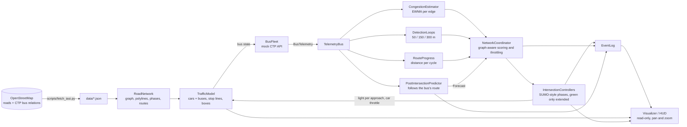
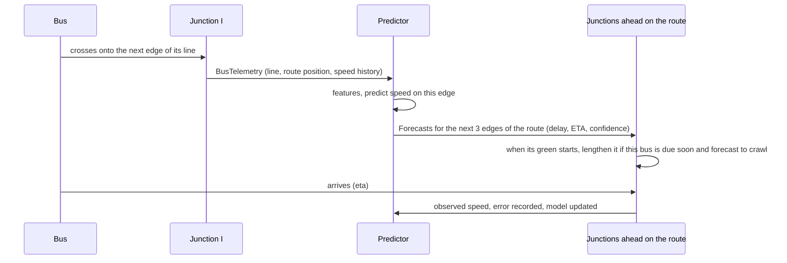

# Smart City Traffic Demo: Architecture

A visual demo of adaptive traffic-signal control on the **real road network of Iași, Romania**, from Breazu to Blocuri Ciurea and from CUG to Tătărași. Individual cars and buses drive on one-lane roads; the buses follow 18 real CTP Iași lines (the ten backbone lines 20, 23, 28, 30, 36, 41, 42, 43, 47 and 52 among them) and double as moving congestion sensors. Only the buses are observed, never the cars, so no light is ever cut short: once per red-green cycle each junction checks how far the buses heading for it got, and lengthens its green only if they covered very little distance. It also avoids releasing cars toward an overloaded junction. An AI module forecasts what each bus will meet on the next links of its route and feeds that forward so the junctions ahead adjust before the bus arrives.

**Target:** Python 3.14 (3.14.8), `pygame-ce`, `numpy`, `networkx`, `pytest`; `osmnx` and `shapely` only to rebuild the dataset (see `requirements.txt`).

**Status:** implemented. The earlier grid-based demo was refactored onto the real map (see `docs/REFACTORING_PLAN.md`); section 12 records what was measured. Run it with `python -m smartcity.main --incident-at 60`.

---

## 1. Overview and data flow

The world (cars, buses, and the signals' effect on them) is simulated microscopically. Controllers see **only** bus telemetry plus their own signal state, never the world's vehicle positions. The buses really are the sensors.



One simulation tick (`dt = 0.1 s`):

1. Each `IntersectionController` advances its phase timer.
2. `TrafficModel` moves every vehicle along its edge polyline: car-following, stop lines, crossing junctions, spawning and removing cars at the gates.
3. `BusFleet` publishes one `BusTelemetry` per bus.
4. The estimator, detection loops and predictor consume the telemetry.
5. Every 0.5 s the `NetworkCoordinator` refreshes loads and throttles. Controllers decide only once per cycle, at the moment a green starts.

Everything except rendering is headless and testable with `pytest`.

---

## 2. The Iași dataset (`scripts/fetch_iasi.py`)

Run once; the output (`data/iasi_core.json`, `data/iasi_routes.json`, about 180 KB) is committed so the app starts offline and tests are deterministic. The raw downloads go to `data/raw/` (git-ignored).

1. **Area.** A box (47.095-47.213 N, 27.465-27.640 E) covering the built-up city: Breazu in the north to Blocuri Ciurea in the south, CUG and Canta in the west and south-east, Tătărași and Podu Roș in the east. The simulated network is about 18 x 15 km.
2. **Roads.** Two Overpass queries (cached in `data/raw/`): the primary, secondary and tertiary ways in the box **plus every way of the chosen CTP relations, whatever its class** (residential, service, ...), so that each bus corridor exists exactly as mapped; and the relations themselves (stops in order, member ways). OSMnx builds the directed graph from the first.
3. **Bus lines.** Eighteen of the 21 CTP bus relations in OpenStreetMap: the **backbone** lines 20, 23, 28, 30, 36, 41, 42, 43, 47 and 52 first, then 19, 29, 44, 46, 50, 6B, 27 and 501. Line 18 is left out (a loop whose outbound and return stops snap onto the same nodes) and so are 30B and 43C, which follow exactly the same roads as 30 and 43 inside this network. For each line the route is built from *waypoints*: its stops snapped to the nearest graph node, or, when OSM lists too few stops (line 52 has none), points sampled along its member ways in order. Waypoints are joined by shortest-time paths in which the relation's own ways cost a twentieth as much, so the path sticks to the mapped line. The return direction comes from the opposite relation, or from a shortest path back when OSM has none (36, 52, 6B); immediate reversals that snapping can create are removed. The result is a cyclic, contiguous edge list per line.
4. **Crop for 60 FPS.** Nodes outside the main strongly connected network (24 one-way stubs and islands) are dropped before routing. Afterwards keep the arterial roads (primary, secondary and tertiary, plus their links) and every edge a bus route needs, then the largest strongly connected component (1,191 edges).
5. **Merge junction clusters.** `osmnx.consolidate_intersections` (25 m tolerance) merges dual carriageways and roundabout nodes into single junctions, which also removes every edge shorter than 30 m. Route edges are mapped through the merge.
6. **Result:** 263 nodes, 667 directed edges (428 km), speed limits from `maxspeed` tags (50 km/h urban default; 20-70 km/h occur), edge polylines, street names, and 18 routes whose loops are 13-33 km long. Stretches between junctions on the outskirts can be several kilometres.

Map data (c) OpenStreetMap contributors, ODbL.

---

## 3. Module layout

Package `smartcity/`:

| Module | Responsibility |
|---|---|
| `config.py` | Frozen dataclass holding all tunables |
| `network.py` | `RoadNetwork`: graph of `Intersection`s and polyline `Segment`s with speed limits and stop lines; phase grouping by heading; turn options; gate selection; `networkx` routing; lat/lon projection |
| `data.py`, `synthetic.py` | Load the committed Iași data into plain `GraphData`/`RouteData`; a small synthetic grid with the same interface for tests |
| `traffic_model.py` | `TrafficModel` and `Vehicle`: the microscopic world and its physical rules |
| `mock_api.py` | `BusFleet` (places buses on their lines, emits telemetry), `TelemetryBus` (pub/sub), `BusTelemetry` |
| `congestion.py` | `CongestionEstimator`: per-edge EWMA of bus speed ratio, load, confidence |
| `detection.py` | `DetectionLoops`: virtual loops at 50/150/300 m before every stop line, built from bus telemetry; finds the buses heading for a junction |
| `progress.py` | `RouteProgress`: how far each bus has travelled along its line (unwrapped odometer and a short history), from telemetry alone |
| `predictor.py` | `PostIntersectionPredictor`: the feed-forward AI module, following each bus's route |
| `controller.py` | `IntersectionController` (phase machine; the per-cycle bus check) and `NetworkCoordinator` (graph-aware loads and throttle, evidence from buses, budget) |
| `events.py` | `EventLog` of forecasts, adjustments, throttles, incidents |
| `simulation.py` | Headless fixed-step engine wiring everything together |
| `visualizer.py`, `hud.py` | `Camera` (projection, pan, zoom), city renderer, dashboard |
| `main.py` | Entry point, key and mouse handling, `--compare`, `--screenshot` |

---

## 4. Road network and signals

**Graph.** Every OSM edge is a one-lane directed `Segment` from one intersection centre to the next along its polyline (`length` from OSM, scaled geometry, `speed_limit`, street `name`, headings at both ends). Two-way streets are two segments; one-way streets are one. Vehicles keep to the right-hand lane (3 m off the centre line).

**Stop line and junction box.** Vehicles stop at the *stop line*, 14 m before the centre of the junction they approach (or 40% of the edge, if shorter). The area between the stop lines is the box.

**Signalised junctions.** Every node with at least three incoming roads (and not a gate) gets signals: 143 of 263 in the Iași graph, which is more than the real city has. Nodes with fewer approaches are plain bends or merges with no signal.

**Phases from geometry.** Incoming approaches are grouped by heading: two approaches whose headings are within 40 degrees of opposite share a green (greedy best match), and an unpaired street has a phase of its own. A crossroads gets two phases, a T-junction two (the through road, then the stem), a five-way junction three. A left turn is any turn of more than 35 degrees to the left; turn shares prefer going straight (U-turns only at dead ends).

**Safety timings (SUMO-style, in `config.py`).** A green never lasts less than `min_green` = **7 s** (no flickering) and is never ended early: it is the standard 20 s, possibly *extended* (below), and only then comes **yellow 3 s**; then an **all-red clearance of 2 s** before the conflicting phase starts. At most 45 s. Phase state is `GREEN → YELLOW → ALLRED → next phase`. Neighbouring junctions start desynchronised.

**Gates.** Nodes within 700 m of the edge of the map with traffic both ways (15 on the Iași graph, at most 16, spread by farthest-point sampling) are gates; the small test grid keeps its own settings (150 m band, 10 gates): cars appear on their outgoing edges and leave when they reach their destination gate.

**Routing.** Cars follow the fastest `networkx` path (Dijkstra on free-flow travel time, cached) from a random gate to another. Buses follow their line's cyclic edge list. Both are plain edge sequences: no random walks.

**Projection.** `LocalProjection` maps latitude/longitude to metres east/north of the map centre (equirectangular); `Camera` maps those to screen pixels with pan and zoom (`Camera.latlon_to_screen`).

---

## 5. Vehicle rules (`TrafficModel`)

Identical in fixed and adaptive mode, in plain Python in the spirit of SUMO's safety rules:

- *Red:* a vehicle holds at the stop line; nothing enters the box while its light is red.
- *Yellow:* a vehicle stops if it can still do so with maximum braking; only vehicles too fast to stop continue.
- *Green:* a vehicle crosses only if there will be room on the start of its next edge when it reaches the junction centre (whoever is last on that edge will have moved on by then, unless it is standing in a queue or stalled), so nobody enters the box without room to leave it.
- *Car-following:* a vehicle keeps a safe distance behind the one ahead along the polyline (`v <= sqrt(2 * a_comfort * room)`), with no overtaking, so vehicles never overlap and never jump across nodes.
- *Speed:* each vehicle drives at its edge's speed limit (cars vary by up to 8%), accelerating at 1.8 m/s² and braking at up to 6 m/s².
- *Both sides pass together:* nothing yields to oncoming traffic. The two opposite streets of a green phase (and a left turn across the oncoming one) go at the same time and simply cross inside the box; when two streams merge into the same edge, the later vehicle falls in behind the earlier one as it lands. This keeps a left-turner from holding up everyone behind it on a one-lane road.
- *Throttle:* when the coordinator meters an approach, cars (not buses) are released no faster than `sat_flow * g`.
- *Incident:* a stalled vehicle parks mid-edge for 150 s. On a one-lane road nobody can overtake, so the lane is blocked.

---

## 6. Sensing: estimator and virtual detection loops

**Estimator.** EWMA of the bus speed ratio (speed over the edge's limit) per edge from mid-edge samples only (30 m past the previous junction, 40 m before the stop line), because speed near a signal reflects the signal. Confidence decays with staleness (`exp(-age / 90 s)`) and load is blended toward a neutral prior (0.25), so an unvisited edge is *unknown*, not *clear*.

**Detection loops.** Each approach has virtual windows 50, 150 and 300 m before its stop line. A bus counts toward a window when its *road distance* to that stop line is within it, and the windows reach back across junctions: the loops are indexed by walking upstream edges that can turn into the approach. From the buses inside, a window yields counts, speed ratios and a density estimate:

- buses still moving contribute their slowdown (`1 - speed ratio`), weighted 0.5 / 0.3 / 0.2 from near to far;
- a *standing* bus (under 30% of the limit) proves a queue at least as long as its distance, so it sets a floor on how full the approach edge is (a bus 80 m back on a 150 m edge means a half-full edge, not a jam; one standing on the previous street means the queue covers the whole edge);
- a standing bus within 40 m of its own stop line is ignored (it is waiting for its signal or pulling away).

The density feeds the load estimate that the throttle uses; the windows' other job is to say which buses are heading for a junction (`buses_near`). A bus on an earlier edge counts only if *its own route* continues onto the approach within the next three edges.

**Route progress.** `RouteProgress` turns each telemetry record into a distance along the bus's line (position of its edge on the route plus the distance along the edge, unwrapped over laps) and keeps a one-second history. `travelled(bus, now, span)` answers how many metres the bus covered during the last `span` seconds (or `None` if it has not been watched that long).

---

## 7. Global optimisation across the graph

1. **Graph-aware downstream gating (throttle).** For each approach the coordinator looks at every edge it can release into *and at the junction at the end of that edge*: the worst of `load(edge)` and `0.85 * junction_load(next node)`, where a junction's load is the mean of its two most loaded approaches. It meters car releases only when that is clearly worse than the edge the cars are leaving (backpressure: do not shift the bottleneck):

   ```
   excess = downstream - max(rho_gate, load_up)
   g      = 1 if excess <= 0 else clamp(1 - excess / (rho_block - rho_gate), 0, 1)     # rho_gate 0.65, rho_block 0.85
   ```

   So releasing onto a perfectly free edge is still throttled when the junction it leads to (say a rush-hour Podu Roș) is overloaded. Metering is waived while a bus is in the 150 m window of the approach, because buses cannot overtake the cars they would be held behind.

2. **Physical spillback.** The world enforces that nobody enters a box without room to leave it, so a queue that reaches a junction blocks that approach on green too.

3. **The per-cycle bus check (the only observed-evidence extension).** Each phase remembers when it last turned green. When it turns green again, that is one red-green cycle later, and the controller asks, for every bus within 300 m of one of the phase's stop lines whose route continues onto it: *how far did this bus get during the cycle?* The answer is compared with what the speed limit would have allowed:

   ```
   share = metres travelled during the cycle / (cycle length * speed limit)
   if share < 0.30 for the worst-held bus:
       extension = 12 s * (1 - share / 0.30) * downstream openness    # scaled down toward 0 as the streets ahead jam
   ```

   **Downstream openness looks two junctions down the graph.** More buses means more greens asking for extra time, and a chain of greens that each push traffic toward a jam is how a local jam turns into a network-wide gridlock. So `downstream_openness(approach)` is the worse of two checks on the `networkx` graph: (a) the edges the approach releases into, and the junction at the end of each (as for the throttle); and (b) one junction further, every edge reachable from there without turning straight back (`dload2`, weighted 0.95), again with the load of the junction it leads to. When either is over `rho_gate` the extension shrinks, and at `rho_block` it is zero: no green is lengthened to push more vehicles toward a street whose next junction is already full. The same openness scales the predictive extension.

   Only a bus that was watched for the whole cycle is judged; a bus that arrived during the last red and then crossed is not "low". If every bus got through, nothing changes. The extension is added to that green only; the budget below and `max_green` (45 s) cap it. The log says exactly why, for example: *bus B21 L43 covered 113 m in the last 50 s cycle (14% of free flow)*.

4. **Feed-forward from the AI forecasts.** A forecast that a bus due within 30 s will make low progress on an approach of the starting phase (predicted density at least 0.2, confidence at least 0.3) lengthens the green that is starting by 6 s, once per forecast. This is the same idea as the cycle check, applied before the bus has been seen to stall.

5. **Extension budget.** Total extension seconds across the network per rolling minute are capped at 1.2 s per signalised junction (172 s for the 143 signals of the Iași graph; never below 30 s, so a small network still works; `budget_seconds` sets an explicit cap), and extensions are damped when a neighbouring junction just extended (`networkx` neighbours). The cap grows with the network, so a bigger map is not starved of extensions and a small one is not flooded.

6. **No early endings.** Because only buses are observed, a green is never shortened and never cut off: phases keep their fixed order and the standard length, so no street can be starved.

Removed after measurement or on principle: a "spillback guard" that skipped or cut short phases whose exits looked full (it cost buses a few points and did not reduce jams); score-sized greens, early switches and out-of-order jumps, which decided about the *cars* from estimates and shortened some greens to lengthen others. Their code and settings are gone.

---

## 8. AI post-intersection prediction (feed-forward, along the route)



**Trigger.** A bus's telemetry shows it has moved onto a new edge of its line.

**Features** (over its last 3 edges): mean speed ratio, last ratio, delay rate (fraction of time lost), trend. **Model:** an EWMA baseline at cold start, then an **online ridge regression** (NumPy, window of 200 outcomes) after 25 outcomes, predicting the speed ratio on the edge just entered. Rolling MAE of speed and ETA is shown on the HUD.

**Following the predefined route.** Telemetry carries the bus's line and position along it, and the predictor looks the line up in the public route table. It forecasts the edge the bus just entered and the next two edges **of that route** (wrapping around the loop), each with `predicted_density = 1 - ratio`, an ETA built from edge lengths and limits, a `predicted_delay` (extra seconds over free flow on that edge) and a confidence that falls with each hop. When the bus clears the next junction, the window moves one edge forward and fresh forecasts are issued ahead of it.

**Consumption.** When a phase turns green, forecasts for its approaches whose bus is due within 30 s and is predicted to make low progress lengthen that green by 6 s (`PREDICTIVE_EXTEND`), once per forecast. Nothing in the forecast can shorten or end a green. The forecast also raises the `fc_load` of its edge, which feeds the junction loads used by the throttle. Because the regression shrinks toward the mean, predicted densities are modest, so the trigger threshold is low (0.2) and predictive extensions are rare.

---

## 9. Mock API (the bus feed)

- In-process, 10 Hz of simulation time, no network. It stands in for a high-rate AVL feed.
- 100 buses on 18 CTP lines at 100% traffic: **4 on every standard line** (19, 29, 44, 46, 50, 6B, 27, 501) and **6 to 8 on every backbone line** (20, 23, 28, 30, 36, 41, 42, 43, 47, 52; one bus per 3.3 km of loop, clamped to 6-8, so 20, 23, 28, 36, 41 and 47 get 6 and 30, 42, 43 and 52 get 8). They share the road with cars, queue at the same lights and obey the same junction rules.
- **Staggered headways.** The buses of a line start evenly spaced around its loop (equal headways of loop length / buses, for example 4 km on line 30) with at most 40 m of jitter, on a free spot: if another line's bus is already there the new one is nudged along the loop. Buses added when the traffic amount goes up are put in the middle of the widest gap of their line, and thinning removes the bus whose neighbours are closest together, so the headways stay even at any traffic amount.
- Each tick, one `BusTelemetry` per bus: ID, line number, position along the line, coordinates, distance to the next stop line, speed, the edge's speed limit, accumulated delay. Consumers `subscribe`; a ring buffer keeps recent records for the HUD.
- Deterministic given a seed. Cars are *not* in the feed.

---

## 10. Visualizer and dashboard

- **Projection and camera.** Latitude/longitude to metres to screen, with mouse-wheel zoom about the cursor, drag to pan, `F` to fit, `+`/`-` and arrow keys. The road layer is cached and only re-rendered when the view settles (while dragging, the old layer is shifted). Road width is exaggerated when zoomed out and true to scale when zoomed in.
- **Look.** Dark theme with asphalt-grey road vectors sized by road class, sleek junction rings, neon stop-line bars for each approach (green `#39FF14`, yellow, red `#FF1744`), cars as small blue rectangles, buses as long rectangles coloured neon red-amber-lime by speed with their line number chip (one chip per 26 x 16 px cell, so a crowded centre stays readable), faint corridors in a distinct colour for each of the 18 CTP lines (`L`; the legend lists them all), landmark labels (Copou, Păcurari, Gara, Piața Unirii, Palas, Podu Roș, Tudor Vladimirescu), rings where an adjustment fires, cyan diamonds for AI forecasts, a red X on the stalled vehicle, a scale bar.
- **HUD panels.** Live CTP telemetry table (bus ID, line, speed, distance to the line, delay, AI extra delay ahead); AI predictions (model, error, upcoming forecasts with predicted delay); the three loudest virtual detection loops; automated cycle adjustments (every override of the standard timer, with the reason: `EXTEND`, `PRED-EXT`, `THROTTLE`); metrics.
- **Keeping 60 FPS with 100+ buses.** Drawing: each vehicle is projected once per frame (polyline pieces carry precomputed unit tangents, so a position lookup is a bisect and a multiply) and skipped when off screen; stop-line geometry is computed once; text is measured and rendered once per distinct string (`CachedFont`, bounded) instead of every frame; the dashboard's KPIs are computed once per tick, not once per frame. Simulation: the coordinator asks the predictor about every edge on every refresh, so forecasts are indexed by target edge instead of scanned per edge; gate-to-gate routes are cached `networkx` paths; vehicles are kept per lane so car-following looks only at the vehicle ahead. Measured: see section 12.
- **Keys.** `B` adaptive/fixed, `I` incident, `Space` pause, `1`/`2`/`4`/`8` speed, `H` heat layer (off / true occupancy / estimated load), `L` bus lines, `[` `]` traffic amount, `\` normal traffic, `K` / `Shift+K` or a click on a key point for rush hour, `R` reset, `Q` quit.
- **Traffic amount and rush hour (runtime controls).** `Simulation.set_traffic_percent` takes 0 to 1000 (100 is normal) and `step_traffic` walks the ladder 0, 10, ... 100, 150, 200, 300 ... 1000. It scales the car spawn rate at every gate and the bus fleet (the normal 100 buses split over the 18 lines; 1000% is 1000; 0% is none) and changes the vehicles already on the map at once: lowering removes a random share of the cars and the most recently added buses, raising scatters extra cars and puts extra buses into the widest gaps of their lines, 0% empties the map and 100% after 0% brings back a normal start. Buses taken off the map are forgotten by the detection loops, the odometer and the predictor, so no ghost telemetry remains. `set_rush_point` puts one of the 8 key points under pressure: the nearest signalised junction becomes a rush node, `rush_seed` commuter cars are placed on gate-to-gate routes through it straight away, and an extra stream of `rush_extra` times the normal gate demand (also scaled by the traffic amount) is routed through it from every gate, with no U-turn there. Pressure is thus extra *demand through the junction*: no signal or algorithm is changed. Reset keeps both settings. The starting amount is the global `TRAFFIC_AMOUNT` in `config.py` (1.0 is 100%; `Config(traffic_amount=...)` per run), applied when a simulation is built; the keys and `--traffic` move it afterwards. Rush hour places its seeded commuters within `rush_reach` (2 km) of the key point along their trips, because trips across the whole city are 15 km long and cars spread over them would hardly load one junction. Command line: `--traffic PERCENT`, `--rush KEY_POINT`.

---

## 11. Testing strategy

Everything except the window is headless. 165 tests:

- **Network and geometry:** projection round trip, compass names, polyline position and lane side on a bent road, stop-line set-back; phase grouping on crossroads, T, skewed, five-way and two-approach nodes; turn options without U-turns; gates; routing.
- **Iași dataset:** the network is city-wide (at least 12 x 10 km, 100+ signals), 16 to 20 lines, every backbone line (20, 23, 28, 30, 36, 41, 42, 43, 47, 52) present, flagged and contiguous with no repeated colour or duplicate route, backbone routes run along the streets they serve, every gate reaches every other, every signalised junction has valid phases.
- **World rules:** stop line on red, proceed on green, queue gaps, edge speed limits, wait when the exit is full, yellow, throttle spacing, buses not throttled, both sides of a green phase crossing in lockstep, a left-turner holding up neither the cars behind it nor the oncoming side, merging streams falling in behind one another, stalled vehicle, cars follow gate-to-gate routes.
- **Signals:** opposite lights match at every junction at every tick (300 s of the real map); one phase non-red at a time; every street served; phase order green-yellow-all-red; **7 s minimum green, 3 s yellow and 2 s all-red measured**, including with adaptive extensions; **a green is never shorter than its standard time and its planned length only ever grows**.
- **Sensing and controllers:** detection windows including across junctions, standing-bus rules, queue occupancy, route-aware `buses_near`; the route odometer (laps, history, unjudgeable buses); **the per-cycle check: a bus that barely moved gets the green extended, one that made good progress changes nothing, extensions scale with the shortfall, no judgement without a whole cycle of history or a previous green, far or off-route buses ignored, no extension into jammed streets *or when the junction two hops on is jammed* (also for predictive extensions), cap, budget and its growth with the number of signals, fixed timers unaffected**; the graph-aware throttle (an overloaded *downstream junction* throttles an upstream release onto a free edge) and its bus waiver; predictive extension.
- **Prediction:** forecasts follow the route for three hops and wrap; the window moves ahead as the bus clears junctions; unknown lines get one hop; error recording, expiry, ridge learning.
- **Fleet:** 4 buses on every standard line and 6 to 8 on every backbone line (100 in all); equal headways at the start, new buses go into the widest gap and thinning keeps the spacing even.
- **Whole runs on the real map (both control modes):** no vehicle ever crosses a stop line on red, no two vehicles overlap, the box is clear when a new phase turns green, buses and cars never leave their routes, and adaptive control stays close to fixed timers while never cutting a green short. At 100% and 300% traffic (100 and 300 buses, up to 1,400 cars) the same checks run every tick, and the signal timings are measured again: no green under 7 s, every yellow exactly 3 s, every all-red exactly 2 s; the detection loops track every bus and their 50 / 150 / 300 m windows nest.
- **Traffic amount and rush hour:** the ladder and its clamps; 100% changes nothing (identical run); 0% leaves no cars or buses and nothing spawns; the global `TRAFFIC_AMOUNT` sets the starting traffic; bus counts at 10/50/150/300/1000%; cars thinned or added at once; the spawn rate follows the percentage; removed buses are forgotten by every consumer; returning from 0% restores a normal fleet; lanes stay ordered at 1000%; the eight key points exist and each maps to a real signalised junction; case-insensitive choice and rejection of unknown names; cycling; commuters routed through the junction; rush hour raises the cars near Copou and Podu Roș at least twofold; lifting it; rush hour at 0% stays empty; keys, Shift+K, backslash, clicking a key point (and not dragging) and command-line validation.
- **Rendering:** every line has its own colour and the legend lists all 18; one badge per crowded spot; the font cache returns shared surfaces and stays bounded; camera projection and zoom invariants, every heat and line mode on both maps, the interactive loop with keys and mouse, screenshots, all under `SDL_VIDEODRIVER=dummy`.

---

## 12. Results, risks and open items

**Measured** (`python -m smartcity.main --compare --seeds 4`: a vehicle stalls on the busiest bus corridor from t=120 s to t=270 s, 600 s per run, normal traffic of 450 cars and 100 buses):

| mode | bus time lost | car speed (share of limit) | edge-seconds half-occupied | cars exited | adjustments |
|---|---|---|---|---|---|
| fixed timers | 20.6% | 88% | 39 | 276 | 0 |
| adaptive | 20.9% | 88% | 39 | 276 | 299 |

Heavier and more concentrated traffic (bus time lost / car speed / half-occupied edge-seconds / cars exited, fixed then adaptive; 3 seeds):

| scenario | fixed timers | adaptive |
|---|---|---|
| 100%, rush hour at Copou (600 s) | 21.5% / 79% / 307 / 280 | 21.8% / 79% / 227 / 280 |
| 300% (480 s) | 25.3% / 81% / 747 / 622 | 25.5% / 80% / 922 / 621 |
| 300%, rush hour at Podu Roș (480 s) | 30.4% / 64% / 4588 / 658 | 30.6% / 64% / 4655 / 665 |

Ablation at 300% (5 seeds, 360 s, two seed sets; bus time lost / car speed / half-occupied edge-seconds / cars exited): seeds 1-5: fixed 25.2% / 81% / 597 / 481, everything on 25.3% / 81% / 788 / 480, throttle only 25.4% / 81% / 697 / 481, extensions only 24.8% / 82% / 672 / 480; seeds 6-10: fixed 25.2% / 82% / 615 / 464, everything on 25.1% / 81% / 670 / 463, throttle only 25.1% / 81% / 655 / 463. The second-hop check on its own changes nothing measurable (784 against 788 half-occupied edge-seconds with it switched off).

Measured on an otherwise idle laptop with the window off screen (`SDL_VIDEODRIVER=dummy`, drawing a full frame and stepping the simulation):

| traffic | vehicles | drawing | one tick | frame at 1x / 4x / 8x |
|---|---|---|---|---|
| 100% | 450 cars, 100 buses | 7.5 ms | 2.1 ms | 8 / 9 / 10 ms: 60 FPS |
| 300% | 1,350 cars, 300 buses | 12.6 ms | 4.8 ms | 13 / 16 / 19 ms: 60 / 60 / 53 FPS |
| 1000% | 4,500 cars, 1,000 buses | 30.8 ms | 15 ms | 33 / 41 / 51 ms: about 30 / 24 / 20 FPS |

Before the work in section 10 the same frame at 100% cost about 11 ms on this map. A 15-minute run at 100% simulates in about 20 s headless.

- **With only bus evidence and extend-only greens, adaptive control is close to a wash.** On the city-wide map the per-cycle check fires a few hundred times in ten minutes (299 adjustments at 100%) and each time cites a bus that really was held. Bus time lost and car speed end up within half a point of fixed timers at every traffic amount, and throughput within 2%. Half-occupied edge-seconds are noisy (a handful of edges out of 667 for a few minutes): lower with adaptive control at 100% with rush hour at Copou (227 against 307), higher at 300% (922 against 747; in a second seed set 670 against 615), and the same under rush hour at Podu Roș. The ablation says the throttle and the extensions each add a little to that count and neither buys back time for the buses. Neither mode gridlocks at 300%; the saturation that matters is at 1000% (below). An earlier version that also shortened some greens to lengthen others (score-sized splits and early switches, which decided about cars from estimates) measured better for buses on the small central map; removing those, as required because the cars are not observed, gives that up.
- **Scale is where the safety rules earn their keep, not the gains.** Run every tick at 100% and at 300% (300 buses, up to 1,400 cars, 143 signals) the checks find no overlap, no vehicle crossing a stop line on red, no green under 7 s, every yellow exactly 3 s and every all-red exactly 2 s; vehicles advance at most one tick of the fastest speed limit per tick and only move on to an edge that starts where the last one ended. At 1000% (980 buses, 4,500 cars) the lanes stay ordered and no red is run either.
- **The second-hop check is a guard, not a gain.** It refuses to lengthen a green when the junction two hops down is jammed. In these runs loads that high are rare (see the half-occupied counts above), so it rarely fires; the test suite exercises it with a forced jam.
- **Free-flowing both sides help every mode.** Letting both sides of a phase pass together (no yielding, entry room judged for the moment of arrival) made the baseline itself much better than before. On the earlier central map (the numbers from before the city-wide rebuild): at the default demand fixed timers lost 36.2% of bus time (was 38.0%), cars averaged 64% of the limit (was 59%), and half-occupied edge-seconds fell from 328 to 179.
- **Differences from the request.** CTP's lines as described in an earlier brief (28: Dacia - Podu Roș - Triumf; 41: Dacia - Podu Roș) do not match OpenStreetMap, where line 28 is Dacia - Copou and line 41 is Blocuri Ciurea - Piața Independenței; the dataset uses the OSM relations, since that is what can be queried. OSM has 21 CTP bus relations; 18 are simulated (the ten backbone lines and eight others). Line 18 and the variants 30B and 43C are left out (see section 2). Line 52 has no stops in OSM, so its path follows its mapped ways. OSM relations are volunteer-maintained and may differ from CTP's current timetable, and a line is simulated as a loop (out and back) at the speed limit with no stops or timetable (buses never dwell). With 4 buses on a standard line of about 30 km the headway is 7 to 8 km of loop, which is sparse by design.
- **Simplifications.** One lane per direction whatever OSM `lanes` says; only primary/secondary/tertiary roads (plus every road the 18 lines use), so most residential streets are absent; every junction with three or more approaches is signalised, whereas only some are in reality; no pedestrians, lane changes or turn lanes; no collision physics inside the box (opposite streams and left turns pass through each other there); unsignalised bends and merges give way only by the room check. Speed limits come from `maxspeed` tags with a 50 km/h urban default.
- **Nobody yields.** A model that made left-turners wait for gaps was dropped because on one lane the waiting vehicle blocked its whole approach while the oncoming side flowed. Over ten simulated minutes the number of vehicles standing at a green line six seconds or more into the green fell from 468 to 13 (the rest wait for a full road ahead).
- **Predictive extensions are rare.** The model works but regresses to the mean, so few forecasts are dense enough to act on; the per-cycle check does most of the work. ETA error is large (roughly 15-25 s) because forecast arrivals ignore waiting at red.
- **Bus-only sensing** means unvisited edges have no fresh data; confidence decays to a neutral prior, so the controllers see the *neighbourhood of the buses*, not the whole city.
- **Rush hour** is extra demand routed through one chosen key point (see section 10), not a time-of-day profile; the key point is the nearest signalised junction to the label, which can be 100-200 m away. On the city-wide map the seeded commuters are placed within 2 km of the key point (`rush_reach`) so the pressure lands where it is meant to; over two simulated minutes the average number of cars within 400 m of Copou or Podu Roș rises at least twofold (a test).
- **At 1000% the city is saturated on purpose.** Ten times the cars and ten times the buses (about 5,500 vehicles) are far beyond what a one-lane network can move, so queues spill back to the gates and `queued at gates` climbs. A frame costs about 33 ms (roughly 30 FPS, and the simulation falls behind real time at 1x because the loop keeps the window responsive); 300% still holds 60 FPS at 1x and 4x. Weights and thresholds are hand-tuned on a few seeds, not optimised.

---

## 13. Running it

```bash
python3.14 -m venv .venv && source .venv/bin/activate && pip install -r requirements.txt
python -m smartcity.main --incident-at 60      # interactive demo on Iași (press B to compare with fixed timers)
python -m smartcity.main --map grid            # the small synthetic city
python -m smartcity.main --compare             # headless fixed vs adaptive table
python scripts/fetch_iasi.py --refresh         # rebuild the dataset from OpenStreetMap (needs network)
pytest                                         # tests (headless)
```
