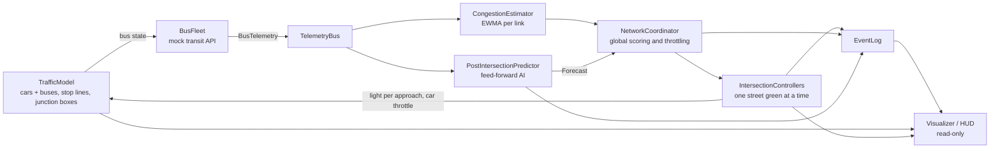
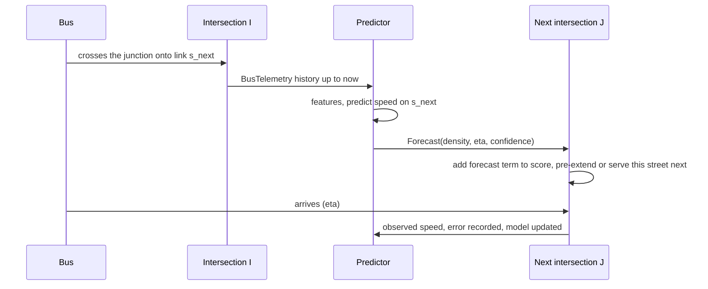

# Smart City Traffic Demo: Architecture

A visual demo of city-wide adaptive traffic-signal control. Individual cars and buses share one-lane roads. The buses double as moving congestion sensors: they stream telemetry, and each intersection uses it to extend green where buses slow down and to avoid releasing traffic into congested neighbours. An AI module forecasts downstream conditions after each bus clears a light and feeds those forecasts forward so the next intersections adjust before the bus arrives.

**Target:** Python 3.14 (3.14.8), `pygame-ce`, `numpy`, `pytest` (see `requirements.txt`).

**Status:** implemented. This document was written first and updated where the implementation taught us something; section 11 records what was measured. Run it with `python -m smartcity.main --incident-at 60`.

---

## 1. Overview and data flow

The system is a closed loop. The *world* (cars, buses, and the signals' effect on them) is simulated microscopically. Controllers see **only** bus telemetry plus their own signal state, never the world's vehicle positions. This keeps the demo honest: the buses really are the sensors.



One simulation tick (`dt = 0.1 s`):

1. Each `IntersectionController` advances its phase timer.
2. `TrafficModel` moves every vehicle: car-following, stopping at red lines, crossing junctions, spawning and removing cars at the gates.
3. `BusFleet` publishes one `BusTelemetry` record per bus.
4. `CongestionEstimator` and `PostIntersectionPredictor` consume the telemetry.
5. Every 0.5 s, `NetworkCoordinator` refreshes link loads, throttles and scores, and controllers make their adaptive decisions.

The visualizer only reads state and the `EventLog`. Everything except rendering is headless and testable with `pytest`.

---

## 2. Module layout

Package `smartcity/`:

| Module | Responsibility |
|---|---|
| `config.py` | Frozen dataclass holding all tunables |
| `network.py` | `CityGrid`: intersections, directed one-lane `Segment`s, stop lines, west/east gates, per-approach turn options, car routing |
| `traffic_model.py` | `TrafficModel` and `Vehicle`: the microscopic world and its physical rules (red lines, junction box, following, incidents) |
| `mock_api.py` | `BusFleet` (route setup, telemetry emission), `TelemetryBus` (pub/sub, ring buffer), `BusTelemetry` |
| `congestion.py` | `CongestionEstimator`: per-link EWMA of bus speed ratio, load, confidence |
| `predictor.py` | `PostIntersectionPredictor`: the feed-forward AI module |
| `controller.py` | `IntersectionController` (phase state machine, local optimisation) and `NetworkCoordinator` (global scoring, throttling, budgets) |
| `events.py` | `EventLog`: forecasts, overrides, throttles, incidents |
| `simulation.py` | Headless fixed-step engine wiring everything together |
| `visualizer.py`, `hud.py` | Pygame rendering of the city and the overlay |
| `main.py` | Entry point, key bindings, headless `--compare`, `--screenshot` |

Dependency direction (no cycles): `config` → `network` → `traffic_model` → `mock_api` → `congestion` / `predictor` → `controller` → `simulation` → `visualizer` → `main`.

---

## 3. The city, junctions and signals

**Topology.** A 4x4 grid of intersections, 200 m apart. Every road is a pair of one-lane directed segments (vehicles keep to the right and cannot overtake). The west and east edge nodes also have a 100 m gate road (an entry and an exit) where cars enter and leave the map. This gives both junction types:

| Junction | Where | Streets (approaches) | Phases |
|---|---|---|---|
| 3-way (T) | top and bottom edge nodes, the four corners | 3 | 3 |
| 4-way | interior nodes, west/east edge nodes | 4 | 4 |

The code is generic in the number of approaches: a junction with N streets runs N phases. The rectangular geometry limits the demo to four.

**Stop line and junction box.** Each segment runs centre to centre, but vehicles must stop at the *stop line*, 14 m (`box_half`) before the centre of the intersection they approach. The square between the stop lines is the junction box. While a light is red, nothing may pass its stop line and enter the box.

**Phases: one street at a time.** Each approach has its own light. For a 3-way junction:

1. Light 1 green: street 1 may go straight or turn into streets 2 or 3. Lights 2 and 3 stay red.
2. Light 2 green; lights 1 and 3 red.
3. Light 3 green; lights 1 and 2 red.

A 4-way junction does the same with four lights. Between phases, **yellow** (2 s) is followed by **all-red** (1.5 s) so the box empties before the next street starts. The standard timer gives each street 14 s of green. Phase state is `GREEN → YELLOW → ALLRED → next approach`.

**Vehicle rules** (enforced in `TrafficModel`, identically in fixed and adaptive mode):

- *Red:* a vehicle holds at the stop line.
- *Yellow:* a vehicle stops if it can still do so with maximum braking; only vehicles too fast to stop continue.
- *Green:* a vehicle crosses only if the first part of its next link has room for it, so nobody enters the box without room to leave it. A queue spilling back to a junction therefore blocks that approach even on green, which is how spillback arises.
- *Following:* a vehicle keeps a safe distance behind the one ahead (`v <= sqrt(2 * a_comfort * room)`), so queues form and dissolve naturally.
- *Throttle:* when the coordinator meters an approach, cars (not buses) are released no faster than `sat_flow * g`.

---

## 4. Core data structures

```python
@dataclass(frozen=True)
class Segment:
    id: int
    from_node: int
    to_node: int
    length: float  # m, centre to centre
    direction: Dir  # N, E, S, W
    kind: str  # "road", "entry" or "exit"
    stop_pos: float  # m from segment start where vehicles stop on red


@dataclass
class Vehicle:
    id: str
    kind: str  # "car", "bus" or "blocker" (stalled vehicle)
    seg: int
    pos: float
    v: float
    length: float
    vfree: float
    next_seg: int | None  # chosen when the vehicle enters a link
    goal: int | None  # cars: exit gate
    route: list[int] | None  # buses: fixed loop


@dataclass(frozen=True)
class BusTelemetry:
    bus_id: str
    t: float
    x: float
    y: float
    segment_id: int
    dist_to_next_node: float  # m to the stop line of the next intersection
    speed: float
    free_speed: float
    delay: float  # accumulated seconds beyond the free-flow schedule


@dataclass(frozen=True)
class Forecast:
    id: int
    source_bus: str
    target_segment: int
    hop: int  # 1 = link the bus just entered, 2 = the straight-ahead one after it
    issued_at: float
    eta: float
    predicted_speed: float
    predicted_density: float
    confidence: float
    expires_at: float
```

`IntersectionController` holds `approaches` (segment ids ordered N, E, S, W by the side they arrive from), the index of the street being served, the phase, and the elapsed and planned green time. `Score` carries the per-approach terms of the dynamic weighting.

---

## 5. Traffic-flow mathematics

**Estimated link load.** The world uses car-following, not a speed-density formula, but a link's mid-block speed still reflects how congested it is, so the estimator uses the Greenshields inverse as a *proxy*:

```
ratio  <- EWMA of (bus speed / free speed) on this link         # alpha 0.3
load   =  1 - ratio                                              # 0 free flow, 1 stopped
```

Samples are used only from mid-block (at least 30 m past the previous junction and at least 40 m before the stop line), because bus speed in the acceleration and braking zones reflects the signal, not the traffic. Confidence rises with the number of samples and decays with staleness (`exp(-age / 90 s)`), and load is blended toward a neutral prior (0.25) as confidence drops, so a link no bus has visited recently is treated as *unknown*, not *clear*.

**Local optimisation.** If a bus on the green street is within `d_trigger` (120 m) of its stop line and slower than half of free speed, and little green remains, the controller extends the green by `ext = gain * (1 - speed / v_slow)` seconds, capped by `max_green` and by the coordinator's budget. Each extension is an *override of the standard timer* and is logged with its reason.

**Dynamic phase score** per approach (all terms in `[0, 1]`):

```
S = w_p * pressure + w_d * bus_delay + w_f * forecast + w_a * age - w_n * downstream_load
```

- `pressure = max(0, load_up - 0.5 * downstream_load)`
- `bus_delay`: slowness of buses approaching on this street, weighted by proximity
- `forecast`: incoming AI-predicted load, confidence-weighted and decayed with ETA
- `age`: grows while the street is red (anti-starvation)
- `downstream_load`: the worst estimated load among the links this approach releases into

Green durations are shared in proportion to score: `green_i = clamp(base * N * w_i / sum(w), min_green, max_green)` with `w_i = max(S_i, 0) + eps`. Equal scores reproduce the standard timer. A green also ends early when the next street's score beats the current one by a margin.

---

## 6. Preventing cascading bottlenecks

Greedy local optimisation has a known failure mode: clearing intersection A simply dumps the jam onto B, then C. These mechanisms are layered so that no single one has to be perfect.

1. **Downstream gating (throttle).** The coordinator meters car releases from an approach only when the link it feeds is clearly worse off than the link the cars are leaving (the backpressure idea of not shifting a bottleneck):

   ```
   excess = load_next - max(rho_gate, load_up)
   g      = 1 if excess <= 0 else clamp(1 - excess / (rho_block - rho_gate), 0, 1)     # rho_gate 0.65, rho_block 0.85
   ```

   Loads come from bus telemetry and forecasts. Each throttle is logged. *Why relative:* an early version metered whenever the next link looked busy. Under uniform congestion that wasted green on links that were draining fine and cut throughput, so it was changed.

2. **Spillback guard.** An approach is *blocked* when the worst link it feeds has estimated load `>= rho_block`. A blocked street is skipped when the next phase is chosen (as long as another street can still discharge), and a blocked green is cut short after `min_green`. A phase that is about to start on a blocked street gets only `min_green`. (The world additionally enforces the physics: nobody enters the box without room to leave it.)

3. **Neighbour-aware scoring.** `downstream_load` is part of the score (`-w_n`), so green drifts away from streets feeding trouble before the hard rule triggers.

4. **Extension budget.** The coordinator caps total extension seconds for the grid per rolling window and damps extensions at intersections whose neighbours have just extended. This stops the "everyone extends, nothing clears" pathology.

5. **Anti-starvation.** The `age` term grows while a street waits, `max_green` caps every phase, and phases rotate in a fixed order (with skips only for blocked streets and predictive jumps), so every street is served.

6. **Hysteresis.** `min_green`, the fixed yellow and all-red intervals, and an override cooldown prevent flapping caused by noisy speed samples.

7. **Feed-forward.** Section 7 lets intersections pre-adjust *before* load arrives.

---

## 7. AI post-intersection prediction (feed-forward)



**Trigger.** A bus's telemetry shows it has moved onto a new link, meaning it has just crossed an intersection.

**Features** (per bus, over its last 3 links): mean speed ratio, last ratio, delay rate (fraction of time lost), and trend.

**Model.** An EWMA baseline at cold start, switching to an **online ridge regression** (NumPy, sliding window of 200 outcomes, refit every 10) once 25 outcomes exist. It maps `features -> observed speed ratio on the link that followed`. Rolling MAE of speed and ETA is tracked and shown on the HUD.

**Output.**

```
predicted_density = 1 - predicted_speed_ratio
eta               = now + distance_to_stop_line / predicted_speed
```

A hop-1 `Forecast` goes to the link the bus entered. A hop-2 forecast, with half the confidence, goes to the straight-ahead link after it.

**Consumption by the target controller.**

- The street's score gains `w_f * density * confidence * decay(eta - now)`.
- If the street is green and `eta - now <= lead` while little green remains, the controller **pre-extends** (`PREDICTIVE_EXTEND`).
- If the street is red, the controller ends the current green (after `min_green`) and serves that street next, even out of sequence (`PREDICTIVE_SWITCH`).
- A forecast is acted on once and expires at `expires_at`. When the bus leaves the link, the predicted-vs-actual error is recorded and the model is updated.

Because the regression shrinks toward the network mean, predicted densities are modest (mostly 0.0-0.3), so the trigger threshold is low (0.2) and predictive overrides are **rare** (a handful per 10-minute run). See section 11.

---

## 8. Mock API (data source)

- An in-process generator at 10 Hz of simulation time; no network is involved. It stands in for a high-rate, cost-efficient transit AVL feed.
- 18 buses (9 loops, 2 buses each): the perimeter in both directions, the inner ring in both directions, rows and columns as out-and-back lines, and a wide rectangle. Buses share the road with cars, queue at the same lights and are held by the same junction rules.
- Each tick it publishes one `BusTelemetry` per bus: ID, coordinates, distance to the next intersection (to its stop line), speed, and accumulated delay. Consumers `subscribe`, and a bounded ring buffer keeps the latest records for the HUD.
- Deterministic given a seed.
- Cars are *not* in the API. They appear at the eight gates at random (Poisson, 0.08 veh/s per gate), each with a random exit gate, steer toward it (80% of the time they take a turn that gets them closer) and leave at the exit.
- An **incident** ("stalled vehicle") parks a vehicle mid-link for 150 s. On a one-lane road nobody can overtake, so the lane is blocked, a queue builds, and buses report it.

---

## 9. Simulation and rendering

**Timing.** Fixed simulation step `dt = 0.1 s`, decoupled from a 60 FPS render loop. Speed multiplier keys and pause.

**The visualizer draws:**
- roads, and a junction box at every intersection;
- each approach's light as a coloured bar across its lane at the stop line (green / yellow / red), so a vehicle waiting outside the box is visibly waiting at a red line;
- cars (small blue rectangles) and buses (long rectangles coloured green → amber → red by `speed / free speed`, with IDs);
- an optional per-link heat layer (true occupancy, or the load the controllers estimate from buses);
- rings flashing where an override fires, cyan diamonds for dense-traffic forecasts, and a red X on the stalled vehicle.

**HUD overlay panels:**
1. *API stream*: telemetry lines for eight buses, refreshed at about 4 Hz.
2. *AI predictions*: model, MAE, upcoming forecasts, recent outcomes.
3. *Overrides*: every time the algorithm overrides the standard timer, with the reason: `EXTEND`, `PRED-EXT`, `PRED-SW`, `EARLY`, `SPLIT`, `THROTTLE`, `SPILLBACK`.
4. *Metrics*: bus time lost, cars in the network and their speed, cars exited, cars queued at the gates, override count.

**Keys.** `B` toggles adaptive control vs. the fixed-timer baseline, `Space` pauses, `I` triggers the incident, `1`/`2`/`4`/`8` set speed, `H` cycles the heat layer, `R` resets, `Q` quits.

---

## 10. Testing strategy

Because the core is headless, `pytest` needs no display.

- **Network:** junction types (3-way and 4-way), approach ordering, stop line set back from the centre, turn options with no U-turns, T-junction turns, car routing reaches its exit.
- **World rules:** stops at the line on red and not in the box; proceeds on green; keeps a gap in a queue; waits at the line when the exit is full; yellow lets only too-fast vehicles through; throttle spaces cars but not buses; a stalled vehicle blocks the lane and then clears; cars enter and leave at gates.
- **Signals:** a 3-way junction runs 3 phases and a 4-way one 4; only one street is ever non-red; phases rotate in order with yellow then all-red between them; fixed timers never override.
- **Controller logic:** local extension, caps, budget and neighbour damping, throttle and spillback guard, skipping blocked streets, predictive extension and switch, score-driven splits.
- **Invariants over whole runs (both control modes):** no vehicle ever crosses a stop line on red, no two vehicles on a link ever overlap, and the junction box holds no conflicting vehicle whenever a new street turns green.
- **Outcome:** with the incident enabled, adaptive control loses less bus time and spends far fewer link-seconds jammed, while keeping throughput within 15% of the fixed timer.
- **Smoke tests:** the renderer draws every heat mode, the interactive loop handles every key and quits cleanly, and screenshot mode writes a PNG, all under `SDL_VIDEODRIVER=dummy`.

---

## 11. Results, risks and open items

**Measured** (`python -m smartcity.main --compare --seeds 8`: a stalled vehicle blocks the central link from t=120 s to t=270 s, 600 s per run, default parameters):

| mode | bus time lost | car speed (share of free) | link-seconds half-occupied | cars exited | overrides |
|---|---|---|---|---|---|
| fixed timers | 65.7% | 32% | 68 | 287 | 0 |
| adaptive | 61.8% | 30% | 8 | 275 | 271 |

- Adaptive control cuts the share of time buses lose by about 4 points and nearly eliminates half-jammed links. Turning every adaptive feature off reproduces the fixed-timer numbers exactly. The local bus-triggered extensions alone give about 2 points and leave car throughput unchanged; the score-sized greens, early switches, throttle and spillback guard add the rest and most of the jam reduction.
- **It costs cars something.** Over 8 seeds, cars exited fall about 4% and car speed about 6% at the default demand. At lighter or heavier demand (0.06 and 0.12 veh/s per gate) exits fall about 9%. Part of that is metering holding cars at the gates instead of letting them into a stressed network, and part is green time taken from other streets for buses and for shorter, more frequent phases (each phase change costs 3.5 s of yellow and all-red).
- **Predictive overrides are rare.** The forecast model works (it moves from EWMA to ridge, with a speed MAE of roughly 0.5-1.5 m/s) but regresses to the mean, so it seldom predicts anything dense enough to act on. Most of the benefit comes from the reactive features.
- **ETA error is large (roughly 15-25 s)** because the forecast ETA assumes the bus keeps moving, while real arrivals include waiting at red.
- **One street at a time is slow.** A 4-way junction gives each street a quarter of the cycle, so cars average about a third of free-flow speed even without incidents. That is a property of the requested signal scheme, not a bug.
- The world is microscopic but simple: one lane per direction, no lane changing, no pedestrians, and vehicles that must stop for red or the box brake rather abruptly at times. Absolute numbers are illustrative, not calibrated.
- Bus-only sensing means unvisited links have no fresh data. Confidence decays toward a neutral prior, so the controllers see the *neighbourhood of the buses*, not the whole city.
- Weights and thresholds are hand-tuned on a handful of seeds, not optimised. Junctions with more than four streets would need non-rectangular geometry.
- Green-wave signal offsets are out of scope.

---

## 12. Running it

```bash
python3.14 -m venv .venv && source .venv/bin/activate && pip install -r requirements.txt
python -m smartcity.main --incident-at 60      # interactive demo (press B to compare with fixed timers)
python -m smartcity.main --compare             # headless table
pytest                                         # tests (headless)
```
