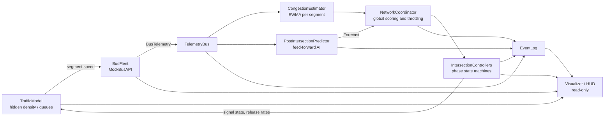
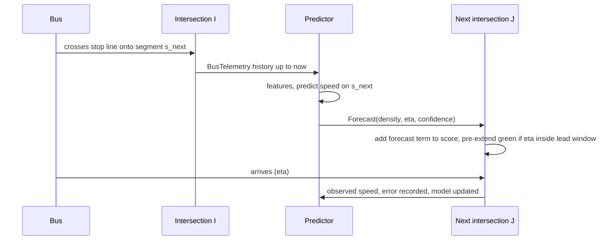

# Smart City Traffic Demo: Architecture

A visual demo of city-wide adaptive traffic-signal control. Mock public-transit buses act as moving congestion sensors. Each intersection reads their telemetry, extends green where buses slow down, and throttles releases into congested neighbours. An AI module forecasts downstream conditions after each bus clears a light and feeds those forecasts forward so the next intersections adjust before the bus arrives.

**Target:** Python 3.14 (3.14.8), `pygame-ce`, `numpy`, `pytest` (see `requirements.txt`).

**Status:** Phase 2 implemented. This document was written first (Phase 1) and has been updated where the implementation taught us something; section 10 records what was measured. Run it with `python -m smartcity.main --incident-at 60`.

---

## 1. Overview and data flow

The system is a closed loop. The *hidden* traffic model decides how fast a bus can move. Buses report that speed. Controllers see **only** bus telemetry (plus their own signal state), never the hidden density. This keeps the demo honest: the buses really are the sensors.



One simulation tick (`dt = 0.1 s`):

1. `IntersectionController`s advance their phase timers and report current signal state.
2. `TrafficModel` updates segment queues and densities using signal states and release rates.
3. `BusFleet` moves buses using their segment's speed (stopping at red) and publishes `BusTelemetry`.
4. `CongestionEstimator` and `PostIntersectionPredictor` consume the telemetry.
5. `NetworkCoordinator` computes scores, throttle factors and extension decisions for the next tick.

The visualizer only reads state and the `EventLog`. The core runs headless, so everything except rendering is testable with `pytest`.

---

## 2. Module layout

Package `smartcity/`:

| Module | Responsibility |
|---|---|
| `config.py` | Frozen dataclasses holding all tunables: grid size (default 4x4), block length, free-flow speed, jam density, min/max green, thresholds, weights, tick rates, RNG seed |
| `network.py` | `CityGrid`, `Intersection`, `Segment`. Topology, directed links, neighbour and downstream lookup |
| `traffic_model.py` | Hidden ground truth. Per-segment density and queue evolution; produces the speed a bus experiences |
| `mock_api.py` | `BusFleet` (bus movement, routes) and `TelemetryBus` (pub/sub, bounded ring buffer); emits `BusTelemetry` |
| `congestion.py` | `CongestionEstimator`. Per-segment EWMA of bus speed ratio, congestion score, confidence |
| `predictor.py` | `PostIntersectionPredictor`. The feed-forward AI module |
| `controller.py` | `IntersectionController` (phase state machine, local optimization) and `NetworkCoordinator` (global scoring, throttling, budgets) |
| `events.py` | `EventLog`. Ring buffer of forecasts, overrides, throttles and incidents (the raw API stream is kept by `TelemetryBus`) |
| `simulation.py` | Headless fixed-step engine wiring all of the above |
| `visualizer.py`, `hud.py` | Pygame rendering of grid, signals, buses and the overlay |
| `main.py` | Entry point, key bindings, adaptive vs. fixed-timer toggle |

Tests live in `tests/`, one file per logic module plus an end-to-end scenario.

Dependency direction (no cycles): `config` → `network` → `traffic_model` → `mock_api` → `congestion` / `predictor` → `controller` → `simulation` → `visualizer` → `main`. The controller depends on `network` and on the estimator/predictor *outputs*, never on `traffic_model` internals.

---

## 3. Core data structures

```python
@dataclass(frozen=True)
class BusTelemetry:
    bus_id: str
    t: float  # simulation time, s
    x: float
    y: float  # world coordinates, m
    segment_id: int
    dist_to_next_node: float  # m to the next stop line
    speed: float  # m/s
    free_speed: float  # m/s on this segment
    delay: float  # accumulated s beyond the free-flow schedule


@dataclass(frozen=True)
class Segment:
    id: int
    from_node: int
    to_node: int
    length: float  # m
    capacity: float  # max vehicles stored on the link
    axis: Axis  # NS or EW


@dataclass(frozen=True)
class Forecast:
    id: int
    source_bus: str
    target_segment: int
    hop: int  # 1 = segment the bus just entered, 2 = the straight-ahead one after it
    issued_at: float
    eta: float  # absolute sim time the bus is expected at the stop line
    predicted_speed: float
    predicted_density: float  # 0..1, fraction of jam density
    confidence: float  # 0..1
    expires_at: float  # absolute sim time


@dataclass
class PhaseState:
    axis: Axis  # axis currently green
    elapsed: float
    planned_green: float
    extended_by: float  # total override seconds this phase
    reason: str  # "BASE", "LOCAL_EXTEND", "PREDICTIVE", ...


@dataclass(frozen=True)
class Score:
    axis: Axis
    pressure: float
    bus_delay: float
    forecast: float
    downstream_penalty: float
    age_bonus: float
    total: float
```

---

## 4. Traffic-flow mathematics

All normalised quantities are in `[0, 1]`.

**Speed-density relation (Greenshields).** The hidden model turns link density `rho` (veh/m) into the speed buses experience; the estimator inverts it.

```
v        = v_free * (1 - rho / rho_jam)
rho_hat  = rho_jam * (1 - v_ewma / v_free)
```

**Congestion score.** Per segment, updated on each telemetry sample from a bus on that segment:

```
v_ewma   <- alpha * v_sample + (1 - alpha) * v_ewma        # alpha ~ 0.3
c        = clamp(1 - v_ewma / v_free, 0, 1)
```

Confidence rises with sample count and decays with staleness (time since the last bus sample), so a segment no bus has visited recently is treated as *unknown*, not *clear*. Stale segments fall back toward a neutral prior.

**Queue and discharge.** Each segment holds a queue `q` (vehicles). Per tick:

```
q <- clamp(q + inflow*dt - outflow*dt, 0, capacity)
outflow = s * g * [approach has green]      # s: saturation flow (veh/s), g: throttle factor (section 5)
```

**Local optimization.** If a bus on an approach is within `d_trigger` of the stop line and its `speed < v_slow` (a fraction of free speed, default 0.5), the controller extends that axis's green:

```
ext = k * (1 - speed / v_slow)          # seconds
```

capped by `max_green` and by the coordinator's extension budget. Every extension is an *override of the standard timer* and is logged with its reason.

**Dynamic phase score.** For each axis the coordinator computes

```
S = w_p * pressure + w_d * bus_delay + w_f * forecast + w_a * age - w_n * downstream_load
```

- `pressure`: max-pressure term, normalised upstream queue minus normalised downstream queue for the movements served by this axis.
- `bus_delay`: normalised delay of buses currently approaching on this axis.
- `forecast`: incoming predicted load (section 6), already confidence-weighted and time-decayed.
- `age`: grows while the axis is red (anti-starvation).
- `downstream_load`: congestion of the segments this axis would release into.

Green time is split in proportion to `S_axis / sum(S)` within `[min_green, max_green]`. Default weights: `w_p=0.35, w_d=0.25, w_f=0.2, w_a=0.1, w_n=0.3` (initial guesses).

---

## 5. Preventing cascading bottlenecks

Greedy local optimization has a known failure mode: clearing intersection A simply dumps the jam onto B, then C. These mechanisms are layered so that no single one has to be perfect.

1. **Downstream gating (throttle).** The coordinator computes, for each approach, the worst estimated load among the links it releases into (`rho_next`). It meters the release rate only when that is clearly worse than the link the traffic is leaving (`rho_up`), which is the backpressure idea of not shifting a bottleneck:

   ```
   excess = rho_next - max(rho_gate, rho_up)
   g      = 1 if excess <= 0 else clamp(1 - excess / (rho_block - rho_gate), 0, 1)     # rho_gate 0.55, rho_block 0.85
   ```

   Loads are estimated from bus telemetry and forecasts, never read from the hidden model. Each throttle is logged. *Why relative:* a first version metered whenever `rho_next` was high. Under uniform congestion that wasted green on links that were draining fine and cut throughput by about 10-20%, so it was changed.

2. **Spillback guard.** If every approach on the green axis would release into a link with estimated load `>= rho_block` (0.85) and the cross axis is not blocked, the green is handed to the cross axis once `min_green` has elapsed. A phase that is about to start with its axis blocked gets only `min_green`. (The traffic model additionally enforces the physics: a movement cannot discharge into a link with no room, and that is the same in both control modes.)

3. **Neighbour-aware scoring.** `downstream_load` is part of the score (`-w_n`), so green time drifts away from flows feeding trouble *before* the hard rule triggers. It is the soft counterpart of mechanism 2.

4. **Extension budget.** The coordinator caps total extension seconds for the grid per rolling window and damps extensions at intersections whose neighbours have already extended. This stops the "everyone extends, nothing clears" pathology. Scores are normalised across the grid, so no single intersection can monopolise the budget.

5. **Anti-starvation.** The `age` term grows while an axis waits, and `max_green` caps every phase, so the cross street always gets service.

6. **Hysteresis.** `min_green`, a minimum hold after a switch, and an override cooldown prevent signal flapping caused by noisy speed samples.

7. **Feed-forward.** Section 6 lets neighbours pre-adjust *before* load arrives, instead of reacting once a queue has formed.

---

## 6. AI post-intersection prediction (feed-forward)



**Trigger.** A bus crosses the stop line at intersection `I` onto segment `s_next`.

**Features** (per bus, rolling over its last N segments): mean speed ratio, accumulated delay, delay rate (s/km), and trend (slope of speed ratio).

**Model.** An EWMA baseline at cold start, switching to an **online ridge regression** (NumPy, sliding window of about 200 samples) once enough samples exist. The regression maps `features -> observed speed on the segment that followed`. Rolling MAE of predicted vs. observed speed is tracked and shown on the HUD. The model is deliberately lightweight: the point of the demo is the *feed-forward integration*, not model sophistication.

**Output.**

```
predicted_density = 1 - predicted_speed / v_free
eta               = now + length(s_next) / predicted_speed
```

A `Forecast` is posted to the intersection at the end of `s_next`, and optionally one hop further with decayed confidence.

**Consumption by the target controller.**

- The axis score gains `w_f * predicted_density * confidence * decay(eta - now)`.
- If `eta - now <= lead` (default about 8 s) and predicted density exceeds a threshold, the controller **pre-extends** green. This is logged as `PREDICTIVE OVERRIDE`, distinct from the reactive `LOCAL EXTEND`.
- A forecast expires at `expires_at` (ETA plus a margin) or when the bus arrives. On arrival the predicted-vs-actual error is recorded and used to update the model.

---

## 7. Mock API (data source)

- An in-process generator running at 10 Hz of simulation time. It stands in for a high-frequency, cost-efficient transit feed; no network is involved.
- Buses follow fixed looping routes across the grid (a mix of straight and L-shaped routes), 18 buses (9 routes, 2 buses each) with staggered starts.
- Each bus takes its segment's speed from `TrafficModel`, stops at red lights, and accumulates delay against its free-flow schedule.
- Each tick it publishes a `BusTelemetry` record per bus (ID, coordinates, distance to next intersection, speed, delay) via `TelemetryBus.publish`. Consumers `subscribe`. A bounded ring buffer retains the latest records for the HUD.
- Deterministic given a seed, which makes the headless tests reproducible.
- A scripted **incident** ("hot spot") raises background demand on one segment, so the demo has congestion to react to. It is triggered at a set time or with a key press.

---

## 8. Simulation and rendering

**Timing.** Fixed simulation step `dt = 0.1 s`, decoupled from a 60 FPS render loop. Speed multiplier keys (1x / 2x / 4x / 8x) and pause.

**The visualizer draws:**
- the city grid (roads and intersections),
- each approach's signal as red or green,
- buses coloured by `speed / free_speed`: green (normal) → yellow → red (slow/delayed),
- an optional congestion tint per segment, and queue indicators.

**HUD overlay panels:**
1. *API stream*: the last ~8 telemetry lines (bus ID, position, distance to next node, speed, delay).
2. *AI predictions*: pending forecasts, predicted density and ETA, rolling MAE.
3. *Override log*: when the algorithm overrides a standard timer, with the reason: `LOCAL EXTEND`, `PREDICTIVE PRE-EXTEND`, `THROTTLE`, `SPILLBACK HOLD`.
4. *Metrics*: running mean bus delay and grid congestion.

**Keys.** `B` toggles adaptive control vs. the fixed-timer baseline (so the benefit is visible live), `Space` pauses, `I` triggers the incident, `1`/`2`/`4`/`8` set speed, `H` cycles the link heat layer (off / true load / load estimated from buses), `R` resets.

---

## 9. Testing strategy

Because the core is headless, `pytest` needs no display.

- **Unit tests:** Greenshields round-trip; EWMA update and staleness decay; throttle factor `g` at the boundaries (`rho_gate`, `rho_block`); spillback guard; extension caps and budget; hysteresis; forecast creation and expiry; ridge fit sanity on synthetic data; deterministic fleet output with a fixed seed.
- **End-to-end scenario:** over four seeds with the incident enabled, adaptive control spends at least 20% fewer link-seconds above `rho_block` than the fixed timer, without worse bus delay (within 3%) or throughput (within 3%). A fixed-mode run must record zero overrides.
- **Smoke tests:** the renderer draws every heat mode, the interactive loop handles every key and quits cleanly, and screenshot mode writes a PNG, all under `SDL_VIDEODRIVER=dummy`.

---

## 10. Results, risks and open items

**Measured** (`python -m smartcity.main --compare --seeds 6`: incident at t=120 s on the central eastbound link, 600 s per run; default parameters):

| mode | bus time lost | link-seconds above `rho_block` | vehicles exited | overrides |
|---|---|---|---|---|
| fixed timers | 45.3% | 290 | 2609 | 0 |
| adaptive | 45.3% | 154 | 2618 | 222 |

- The adaptive controller roughly halves the time links spend jammed (it contains spillback), at equal throughput. **It does not measurably reduce the share of time buses lose**: most of that is waiting at red, which this controller does not target.
- **It does not help when the network is already saturated.** With demand raised from 0.09 to 0.10 veh/s per segment and a nearly fully blocked lane for 400 s, adaptive control was no better than, and in some configurations worse than, the fixed timer (more jammed links, lower throughput). Ablations showed the downstream gating and spillback guard were responsible: when everything is congested there is no good place to send green, and metering only wastes it. The relative-backpressure throttle in section 5 reduced but did not remove that cost.
- The traffic model is a simplified *macroscopic* one (vehicle count per link, one FIFO stream per approach so a full target blocks the whole approach), not a microscopic simulator. Absolute numbers are illustrative, not calibrated.
- Bus-only sensing means unvisited links have no fresh data. Confidence decays toward a neutral prior (load 0.25), so the controllers see the *neighbourhood of the buses*, not the whole city. Coverage depends on route design.
- Weights and thresholds are hand-tuned on a handful of seeds, not optimised.
- Green-wave signal offsets are out of scope and noted only as a possible extension.

---

## 11. Phase 2 build order (completed)

Each step was tested before the next:

1. `config`, `network`
2. `traffic_model`
3. `mock_api`
4. `congestion`
5. `predictor`
6. `controller`: local optimization first, then global coordination
7. `simulation` with the fixed-timer baseline and metrics
8. `visualizer`, `hud`, `main`
9. `.gitignore`, `.vscode/launch.json`, README

---

## 12. Running it

```bash
python3.14 -m venv .venv && source .venv/bin/activate && pip install -r requirements.txt
python -m smartcity.main --incident-at 60      # interactive demo (press B to compare with fixed timers)
python -m smartcity.main --compare             # headless table
pytest                                         # tests (headless)
```
