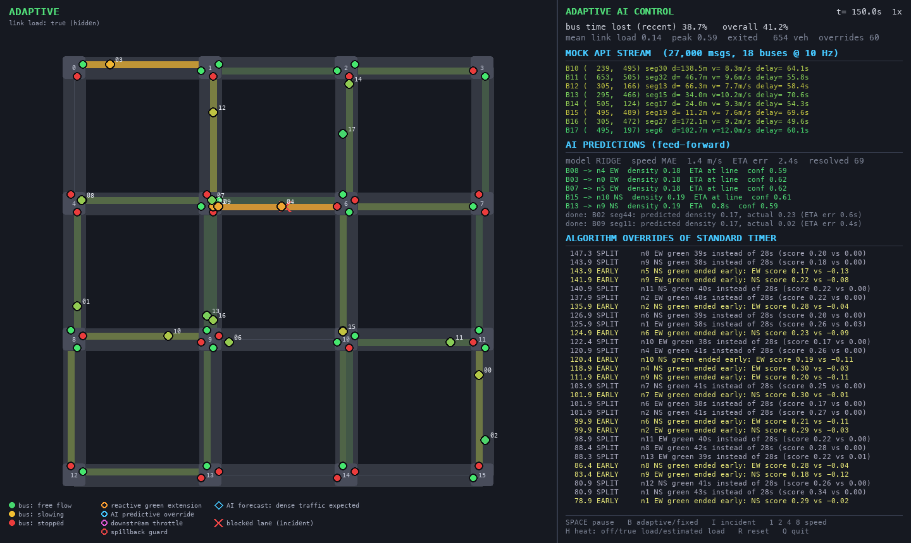

# Smart City Traffic Demo

A visual demo of city-wide adaptive traffic-signal control. Mock transit buses stream telemetry (position, speed, delay); a 4x4 grid of intersections uses it to extend green where buses slow down, throttle releases into congested neighbours, and pre-adjust cycles using an online-learned forecast of what each bus will meet next.



## Run

```bash
python3.14 -m venv .venv && source .venv/bin/activate
pip install -r requirements.txt
python -m smartcity.main --incident-at 60     # interactive window
```

| key | action |
|---|---|
| `B` | toggle adaptive control / fixed-timer baseline |
| `I` | block the central lane (incident) |
| `Space` | pause |
| `1` `2` `4` `8` | simulation speed |
| `H` | cycle heat layer: off / true link load / load estimated from buses |
| `R` | reset |
| `Q` | quit |

Other modes: `--fixed` (start on fixed timers), `--compare` (headless fixed vs adaptive table), `--screenshot FILE --seconds N`.

## What you are looking at

- **Map:** roads, a signal dot on every approach (green / yellow / red), buses coloured by speed. Rings flash where the algorithm overrides a timer; cyan diamonds mark AI forecasts of dense traffic; a red X marks the incident.
- **Right panel:** the mock API stream, AI predictions (model, error, upcoming forecasts), and the log of overrides of the standard timer.

## Docs and tests

[ARCHITECTURE.md](ARCHITECTURE.md) explains the design, the maths and the measured results, including where it does not help. `pytest` runs the headless test suite.
