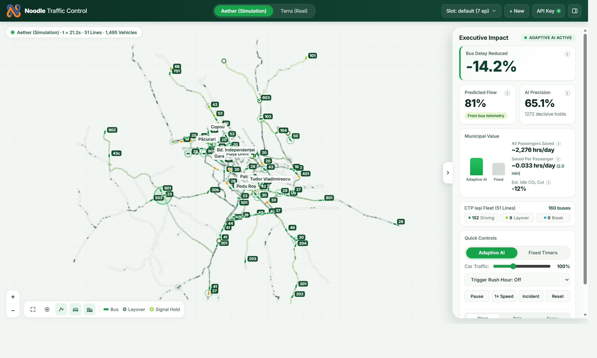

# Noodle Traffic Control — Iași Smart Transit & Adaptive Signal AI

**Noodle Traffic Control** is a real-time adaptive traffic-signal control platform and microscopic urban traffic digital twin built on the **real road network of Iași, Romania** (~18 × 15 km, from Breazu & Copou to Ciurea, CUG, Păcurari, and Tătărași).

Instead of requiring expensive street-level camera networks or inductive road loops, the AI observes **only public transit bus GPS telemetry** through virtual detection loops (`50 / 150 / 300 m` ahead of every stop line), forecasts downstream bottlenecks with online Ridge regression, and dynamically extends green phases or throttles upstream inflows — cutting bus delay while keeping general traffic flowing and strictly obeying SUMO-style signal safety timings.



---

## Two Operating Modes

- **`Aether (Simulation)`** — Full microscopic traffic digital twin of Iași running 51 real CTP Iași bus lines, ~1,500 OD-routed vehicles, 12 Romanian roundabouts, 118 signalized intersections, and live interactive scenario controls (Weather, 24h Rush Clock, Rush Hour hotspots, Incidents, Urban Double-Parking, and Emergency Ambulance green-wave preemption).
- **`Terra (Real)`** — Live real-world transit monitor streaming real-time CTP Iași bus GPS positions and statuses via the **Tranzy Open Data API**, with built-in API key configuration and automatic fallback.

---

## Real-World Iași Simulation Fidelity

- **Multi-Lane Mixed-Traffic Road Network (263 Nodes, 667 Directed Segments):**
  Real 1-, 2-, and 3-lane per-direction Iași boulevards (`356` 1-lane, `226` 2-lane, `85` 3-lane segments) with MOBIL overtaking, mandatory turn-lane pre-selection, smooth lateral lane changes, and single-lane incident bypasses. Streets accurately reflect Iași's mixed-traffic carriageways.
- **Complete CTP Iași Bus Fleet (51 Lines, 160 Buses):**
  Includes all **29 urban** (`6B`, `18`, `19`, `20`, `23`, `23b`, `27`, `28`, `29`, `30`, `30b`, `36`, `41`, `42`, `43`, `43c`, `44`, `46`, `47`, `48`, `50`, `52`, `53`, `54`, etc.) and **22 metropolitan** lines (`101–902`) with realistic per-line fleet counts, articulated (`12.6 m`), standard (`11.0 m`), and minibus (`8.4 m`) vehicle profiles, **228 real CTP bus stops** (curbside & recessed bays with passenger boarding dwell), and realistic terminus layovers (`5–15 min`) plus periodic driver breaks (`15–30 min`).
- **Romanian Roundabouts (*Sensuri Giratorii*, OUG 195/2002 & HG 130/2023):**
  **12 real Iași roundabouts** — 10 unsignalized yield-to-left roundabouts (Păcurari/Canta, Era, Agronomie/Copou, CUG/Tehnopolis, Rond Vechi CUG, Dacia, Tătărași/Ciric, Centura, Cotnari, Țesătura) plus **2 signalized mega-roundabouts** (Podu Roș & Podu de Piatră) — with circular counterclockwise kinematics, gap acceptance, inner-to-outer (*Bandă 2 → Bandă 1*) exit yielding, and **17 unsignalized *Cedează* T-junctions** plus unprotected left-turn yielding.
- **Residential Origin-Destination Traffic (1,183 Apartment Blocks & Houses):**
  Cars follow realistic door-to-door trips (`60%` city-to-building 1–8 km, `20%` outer-to-building 5–20 km, `20%` cross-city through-traffic 5–20 km), keeping ~70–75% of active vehicles inside Iași's urban core and spawning follow-up trips from uncrowded residential streets. Car traffic load (`0–300%`) scales cars independently without altering the scheduled CTP bus fleet.
- **Everyday Iași Urban Dynamics & Interactive Scenarios:**
  Heterogeneous vehicle mix (cars, delivery vans, heavy trucks, CTP buses, emergency ambulances), **Iași's 7 hills** (`249` sloped segments affecting truck/bus climb acceleration), **34 pedestrian zebra crosswalks**, **2 CFR railway crossings**, optional **Urban Friction** curbside double-parking (*"5 min pe avarii"*), **Weather** presets (`Clear`, `Rain`, `Snow`), a **24h Day-Cycle** rush clock, and **Hospital Ambulance** dispatch with automatic signal green-wave preemption.

---

## How the Adaptive Control Algorithm Works

1. **Safety-First Signal Timing:** Opposite approaches share a phase (N+S, then E+W) with SUMO-compliant minimums — at least `7 s` green, `3 s` yellow, and `2 s` all-red clearance. Green phases are **never cut short**; the controller only extends or holds green when transit evidence justifies it.
2. **Bus-Only Virtual Detection Loops:** Buses publish telemetry (`speed`, `segment`, `position`, `at_stop`). Stationary boarding time at CTP bus stops is explicitly ignored so stops never trigger false congestion alerts or wasted green holds.
3. **Feed-Forward Prediction & Learning Slots:** An online Ridge regression model (`PostIntersectionPredictor`) forecasts downstream bus delay along upcoming route legs, while per-junction learned policies persist across runs in named save slots (`data/slots/default.json`, or custom slots created in the UI / CLI).
4. **Executive Impact KPIs:** Tracks smoothed **Bus Delay Reduced (%)**, **Predicted Flow**, **AI Precision**, **All Passengers Saved (hrs/day)**, **Saved Per Passenger (hrs/day & min)**, and **Est. Idle CO₂ Cut (%)**, each with interactive hover explanations.

---

## Quick Start

### 1. Install Dependencies

```bash
python -m venv .venv
# Windows PowerShell:
.venv\Scripts\Activate.ps1
# macOS / Linux:
source .venv/bin/activate

pip install -r requirements.txt
```

### 2. Run the Interactive Web Dashboard (Recommended)

```bash
python -m smartcity.web
# or choose a custom port / save slot:
python -m smartcity.main --web --port 8000
```

Open **http://127.0.0.1:8000** in your browser.

- Toggle **`Aether (Simulation)`** / **`Terra (Real)`** in the top navigation bar.
- Switch between **`Adaptive AI`** and **`Fixed Timers`**, adjust **`Car Traffic`**, trigger **`Rush Hour`** hotspots (Copou, Păcurari, Gara Iași, Piața Unirii, Bd. Independenței, Palas, Podu Roș, Tudor Vladimirescu), toggle **Weather**, **24h Clock**, **Double-Parking Friction**, **Dispatch Ambulance**, or hide/show **Cars**, **Buildings**, and **CTP Routes**.
- Hover over any KPI info icon (`i`) for a concise breakdown of how each metric is calculated.

### 3. Build the Zero-Backend Static Web Bundle (GitHub Pages)

The `docs/` folder contains a standalone browser simulation engine (`web/standalone_sim.js`) bundled with the Iași datasets so the full dashboard runs client-side on GitHub Pages with no Python server required:

```bash
python scripts/build_gh_pages.py
```

### 4. Headless Benchmarks, RL Training & Desktop Mode

```bash
# Fixed-timer vs Adaptive AI comparison table
python -m smartcity.main --compare --seconds 240 --seeds 3

# Train adaptive junction policies into a named save slot
python -m smartcity.main --train 5 --slot my_experiment

# Legacy Pygame desktop visualizer
python -m smartcity.main 60
```

Useful CLI flags: `--traffic 200` (car traffic % from `0` to `1000`), `--rush "Podu Roș"`, `--incident-at 60`, `--fixed`, `--map grid` (small synthetic test grid), `--slot NAME`, `--reset-slot`.

---

## Data & Scripts

All Iași datasets are committed in `data/` so the app runs completely offline out of the box:

- `data/iasi_core.json` — Real Iași arterial & transit road graph (`scripts/fetch_iasi.py`).
- `data/iasi_routes.json` — All 51 CTP Iași urban & metropolitan bus routes and stops.
- `data/iasi_buildings.json` — 1,183 residential apartment blocks and houses (`scripts/fetch_buildings.py`).
- `data/iasi_realism.json` — Multi-lane counts, 12 roundabouts, 17 yield junctions, 228 deduplicated CTP stops, 34 crosswalks, hill grades, rail crossings, and 4 hospitals (`scripts/enrich_iasi_realism.py`).
- `data/slots/default.json` — Pre-trained default adaptive signal policy slot.

Map data © OpenStreetMap contributors (ODbL). Live transit telemetry powered by Tranzy Open Data API (CTP Iași).

---

## Architecture & Tests

- [ARCHITECTURE.md](ARCHITECTURE.md) — System design, traffic-flow mathematics, virtual detection loops, and benchmark methodology.
- [docs/REFACTORING_PLAN.md](docs/REFACTORING_PLAN.md) & [docs/SCALING_PLAN.md](docs/SCALING_PLAN.md) — Evolution from synthetic grid to city-wide Iași network.
- Run the automated test suite (multi-lane MOBIL, Romanian roundabouts, bus stops, residential OD, adaptive controller, and FastAPI/WebSocket API):

```bash
pytest
```
